<p align="center">
  
</p>

<h1 align="center">⚙️ Out of Warranty (Garanti Dışı)</h1>

<p align="center">
  <strong>A turn-based 2D tactical artillery game where service robots fight for spare parts in an abandoned megafactory.</strong>
</p>

<p align="center">
  <a href="https://developer.mozilla.org/en-US/docs/Web/JavaScript"></a>
  <a href="https://developer.mozilla.org/en-US/docs/Web/API/Canvas_API"></a>
  <a href="https://developer.mozilla.org/en-US/docs/Web/API/Web_Audio_API"></a>
  <a href="https://webrtc.org/"></a>
  
  
  
  
</p>

---

**Language / Dil:** [English](#about-the-game) · [Türkçe](#türkçe)

## Contents

[About](#about-the-game) · [Quick start](#quick-start) · [Features](#key-features) · [Controls](#controls) · [Arenas](#industrial-arenas) · [Weapons](#arsenal--weapon-specs) · [Robot roster](#robot-roster-34) · [Architecture](#codebase-architecture) · [Tests](#testing--verification) · [Distribution](#distribution--packaging) · [Licenses](#licenses--third-party-notices) · [Privacy](#privacy--data)

## 📖 About the Game

**Out of Warranty** is a modern browser-based tactical artillery game inspired by the spirit of classic titles like *Wild Ones* and *Worms*, re-imagined with a gritty industrial robotic aesthetic.

In the abandoned foundries, assembly lines, and cooling plants of a desolate megafactory, discarded maintenance robots clash to secure their warranty and claim scarce spare parts. Featuring fully destructible terrain, dynamic crosswind physics, 34 distinct playable robots with active internal modules, a deep workshop metagame with wearable equipment, and serverless WebRTC peer-to-peer multiplayer.

> [!TIP]
> **Zero Dependencies, Zero Build Step:** The game requires no npm installations, transpilers, bundlers (Vite/Webpack), or external libraries. Double-click `index.html` in your browser and play immediately!

---

## 🚀 Quick Start

No local web server, runtime installation, or compilation is required. The game works out of the box via the `file://` protocol:

```bash
# Windows (PowerShell / Command Prompt)
start index.html

# macOS
open index.html

# Linux
xdg-open index.html
```

Simply open `index.html` in any modern web browser (Chrome, Firefox, Edge, Safari).

---

## ✨ Key Features

- 💥 **Fully Destructible Terrain:** Every explosive impact excavates craters and wears down surface props in real-time with sub-step ray-swept collision detection.
- 🤖 **34 Unique Robots & Class Modules:** Maintenance, defense, scout, courier, casting, and heavy demolition units. Each robot has an active `Q` module with deterministic visual cast effects.
- 🎯 **20 Weapons & Tactical Gadgets:** From standard ballistics and cluster grenades to burrowing drills, bouncy clusters, air strikes, tactical grapple hooks, and teleportation beacons.
- 🛠️ **Workshop & Metagame Progression:** Earn **Scrap** and **Service XP** in matches against AI bots to upgrade Chassis, Attachment, and Core branches.
- 🎛️ **24 Wearable Parts:** Customize your bots with optics, heat sinks, gyroscopes, and booster treads that render dynamically on the humanoid canvas skeleton.
- 🌐 **WebRTC P2P Online Multiplayer:** Serverless, direct peer-to-peer 2–6 player rooms with host-authoritative physics, reconnect tolerance, and room code sharing.
- 👥 **Local Hot-Seat & Smart AI:** Local couch multiplayer for 2–6 players on a single keyboard, or single-player vs. ballistic-calculating AI bots across 4 difficulty tiers.
- 🔊 **Procedural Web Audio Engine:** Zero external audio assets to download. All gunshots, ricochets, explosions, and mechanical hums are synthesized directly in code using the Web Audio API.
- 🌍 **Six-Language Support (i18n):** Turkish, English, Simplified Chinese, Russian, Spanish, and Brazilian Portuguese.
- 📦 **Portal Ready:** Built-in SDK bridge for platforms like itch.io, CrazyGames, and Poki.

---

## 🎮 Controls

| Key | Action |
|:---:|---|
| <kbd>A</kbd> / <kbd>D</kbd> or <kbd>←</kbd> / <kbd>→</kbd> | Move robot (steer while airborne) |
| <kbd>W</kbd> or <kbd>↑</kbd> | Jump |
| **Mouse Aim** | Aim weapon angle |
| **Left Click** or <kbd>Space</kbd> | Hold to charge power, release to fire |
| **Right Click** or <kbd>Esc</kbd> | Cancel primed shot |
| <kbd>1</kbd>–<kbd>9</kbd> or **Mouse Wheel** | Select active weapon |
| <kbd>Q</kbd> | Trigger robot's internal skill module |
| <kbd>M</kbd> | Toggle audio mute |
| <kbd>F</kbd> | Toggle full screen |
| In Market: <kbd>1</kbd>–<kbd>5</kbd> | Switch tabs (Ammo, Helmet, Chassis, Attachment, Foot) |
| In Workshop: <kbd>1</kbd> / <kbd>2</kbd> or <kbd>Tab</kbd> | Toggle between UPGRADES and PARTS modes |

---

## 🗺️ Industrial Arenas

Matches take place across 14 hand-crafted industrial arenas with unique tactical layouts:

| Arena | Tactical Environment & Dynamics |
|---|---|
| **Molten Foundry** | Steep outer ramps with a narrow, lethal molten center basin |
| **Night Crane Yard** | Multi-tiered industrial rooftops and high suspended platforms |
| **Overgrown Reactor** | High concrete bunkers flanking a recessed central trench |
| **Lunar Debris Yard** | Low-gravity feel with floating scrap platforms and an uninterrupted lower route |
| **Frost Fracture** | A deadly, bottomless chasm separating two opposing cliff edges |
| **Flooded Laboratory** | Enclosed boundary walls with destructible interior bulkhead barriers |
| **Conveyor Port** | Opposing cargo belts carry grounded robots toward the center once per turn; raised side docks provide an alternate firing route |
| **Steamworks** | Paired pressure vents alternate each turn, launching nearby grounded robots into the air |
| **KEPÇE-8 · Settling Basin** | A low central weir splits two broad dry basins, blocking flat shots while leaving mortar arcs open |
| **TOK-2 · Calibration Benches** | Three low workbenches create short cover pockets and moving decisions between platforms |
| **VUR-5 · Filter Terraces** | Two stepped slopes descend to a shared basin where knockback can dislodge high-ground holders |
| **PUNTA-1 · Weld Gantries** | An elevated bridge speeds traversal while a thin central pylon interrupts direct firing lines |
| **SIZ-7 · Old Filter Bay** | Two shallow side alcoves trade flat-shot cover for mortar exposure beneath a central deck |
| **EMP-80 · Substation Yard** | A high center pedestal grants sightlines but exposes its holder to both flanks |

### Arena Art

| Foundry · far | Foundry · mid | Cooling · far | Cooling · mid |
|:---:|:---:|:---:|:---:|
| 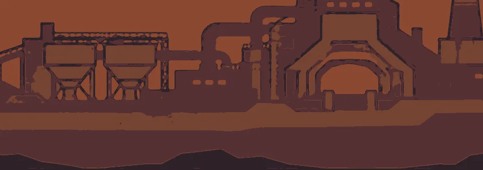 | 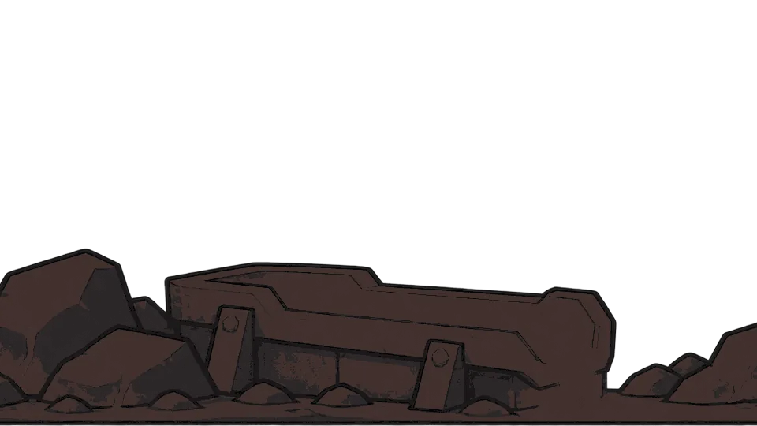 | 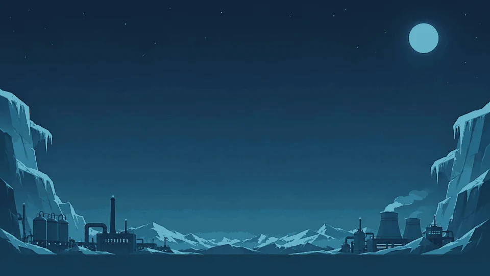 | 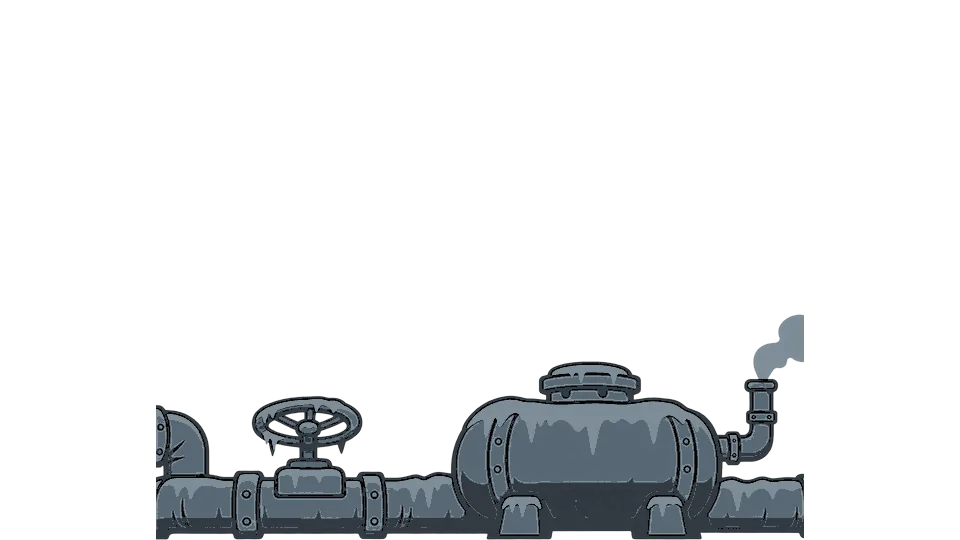 |

### Key Art

| Foundry · FIRIN-3, MAT-6, KES-9 | Cooling Plant · SOĞUT-2, KRİYO-7, DALGA-2 |
|:---:|:---:|
| 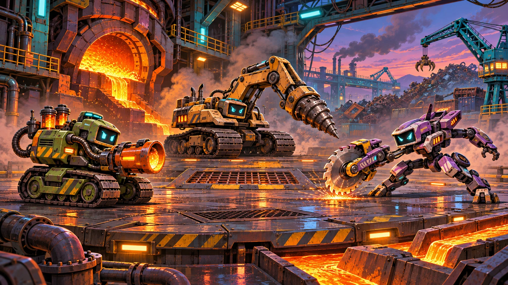 | 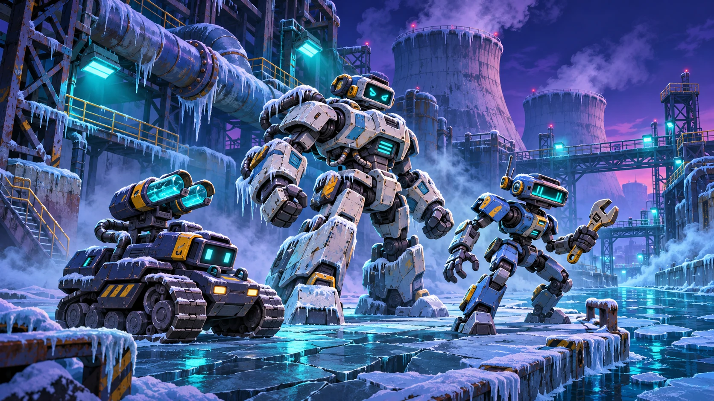 |

| Paint Atelier · ÇİFT-6, HAYALET-4, KANCA-4 | Loading Yard · PRES-4, TEK-8, ZIP-X |
|:---:|:---:|
| 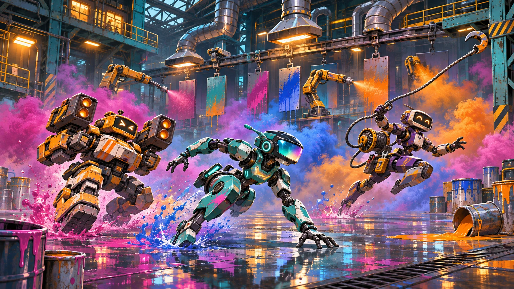 | 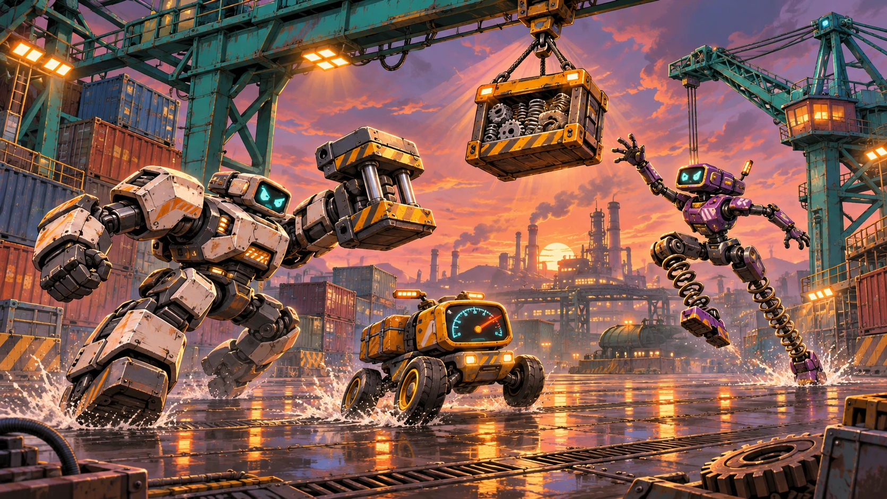 |

### Menu Screen Art

| Robot Count | Character Select |
|:---:|:---:|
| 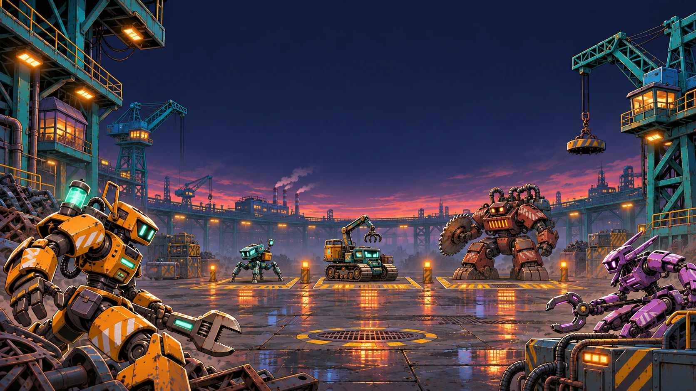 | 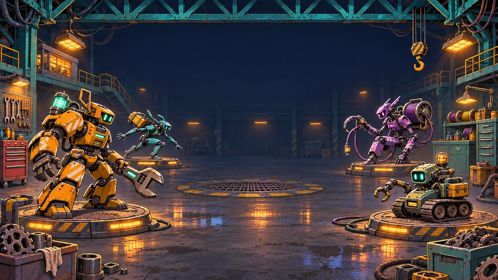 |

| Map Select | Workshop |
|:---:|:---:|
| 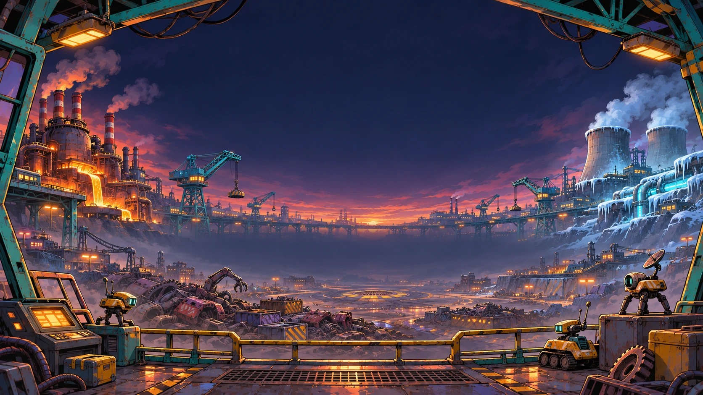 | 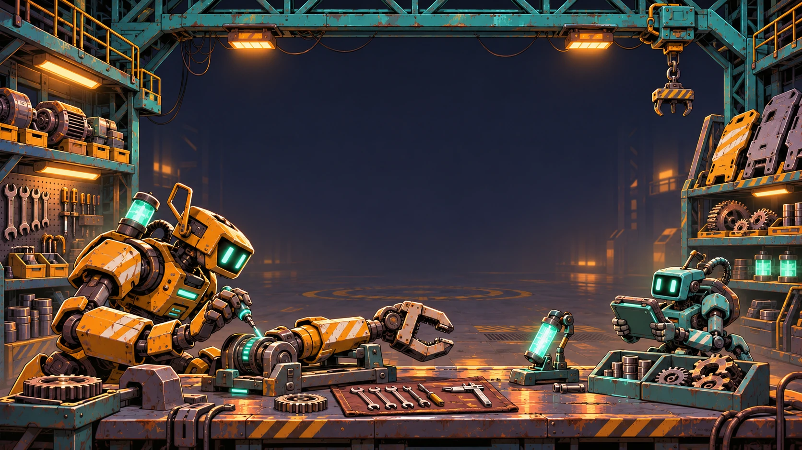 |

| Ammo Market | Tutorial |
|:---:|:---:|
| 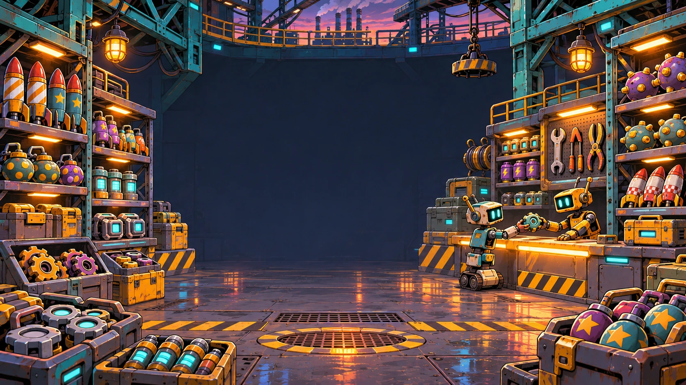 | 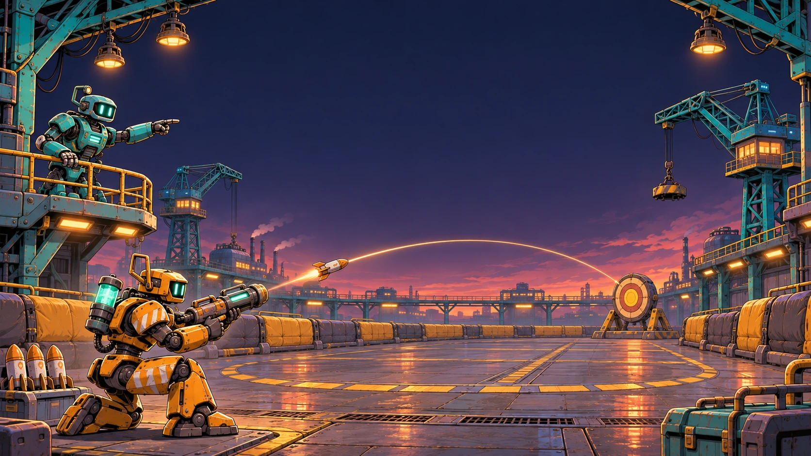 |

| Online Role Select | Join by Code |
|:---:|:---:|
| 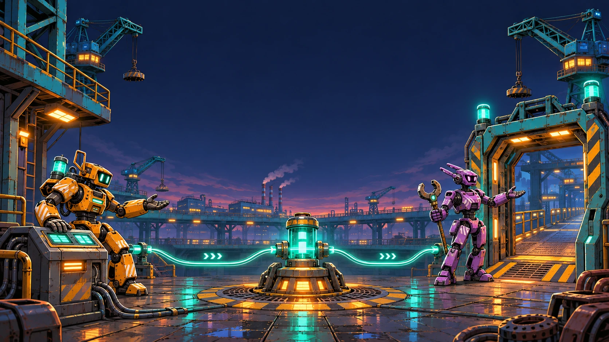 | 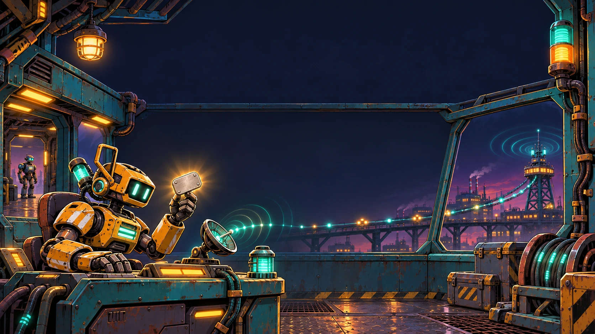 |

| Online Room | Online Loading |
|:---:|:---:|
|  | 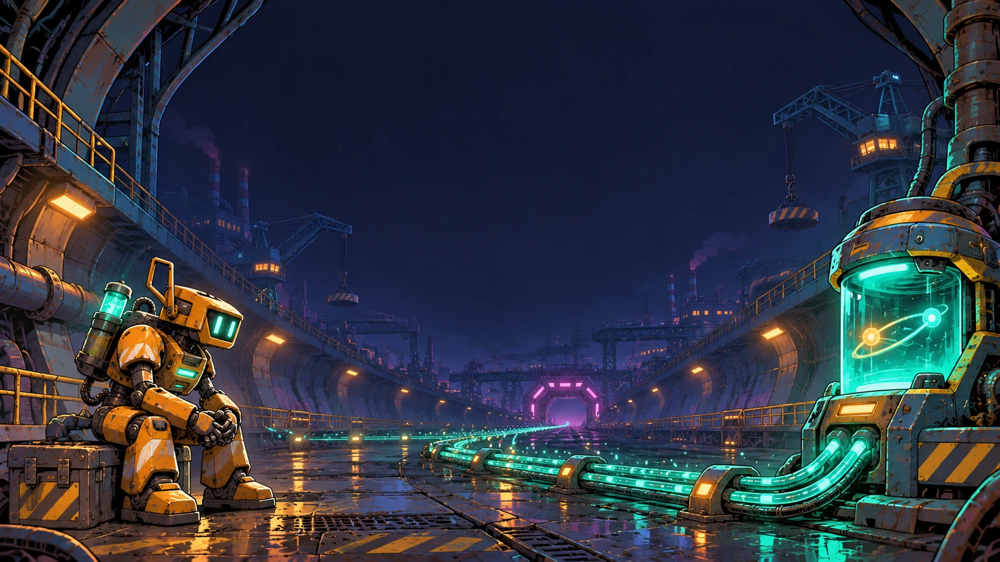 |

---

## 💣 Arsenal & Weapon Specs

The primary **Bazooka** has infinite ammunition. Heavy ordnance and tactical gadgets are limited and can be purchased from the Market using Scrap:

| Ammo / Weapon | Damage & Effect | Blast Radius | Base Ammo | Battle Cap |
|---|---|:---:|:---:|:---:|
| **Bazooka** | Standard Ballistic Rocket (46) | 38 | ∞ | ∞ |
| **Grenade** | Timed Fuse Explosive (40) | 46 | 3 | 5 |
| **Sniper** | High-Velocity Armor Piercing (30 + 40 direct) | 16 | 2 | 3 |
| **Shotgun** | 5-Pellet Cone Spread (16 × 5) | 18 | 2 | 4 |
| **Cluster Bomb** | Aerial Fragmentation (28 + 5 × 18 shrapnel) | 30 | 1 | 3 |
| **Triple Rocket** | 3-Rocket Sequential Volley (28 × 3) | 30 | 2 | 4 |
| **Sticky Bomb** | Surface-Adhesive Contact Charge (44) | 44 | 2 | 4 |
| **Bouncy Bomb** | High-Elasticity Ricochet Sphere (34) | 40 | 3 | 6 |
| **Nuke** | Catastrophic Blast & Mega Crater (80) | 84 | 1 | 2 |
| **Drill** | Subterranean Ground-Boring Torpedo (34) | 30 | 2 | 4 |
| **Landmine** | Proximity Sensor Ground Trap (42) | 40 | 2 | 5 |
| **Napalm** | Persistent Incendiary Flame Field (26 + burn) | 30 | 1 | 3 |
| **Teleport Orb** | Utility — Instantly teleports firer to impact site | 12 | 2 | 5 |
| **Grapple Hook** | Utility — Pulls robot to terrain anchor point | 12 | 2 | 5 |

---

## 🤖 Robot Classes & Anatomical Rig

All 34 robots are built on a shared, data-driven modular humanoid Canvas skeleton:

```
[Helmet / Visor] ─── [Face / Diagnostic Display]
       │
   [Chassis] ──────── [Mission Attachment (Weapon / Backpack)]
       │
[Legs / Treads / Mono-wheel / Hover Rotors / Coils]
```

### Featured Models:
- **FIX-8 (Maintenance):** *Emergency Repair* — Welds damaged armor plates to restore HP in the heat of battle.
- **MIK-0 (Defense):** *Polar Barrier* — Projects a magnetic shield that completely neutralizes the next incoming attack.
- **TEK-8 (Courier):** *Turbo Wheel* — High acceleration dash that rams into enemy robots.
- **PRES-4 (Cargo):** *Press Slam* — Deploys a crushing hydraulic press to obliterate adjacent foes.
- **MAT-6 (Excavation):** *Depth Auger* — Bores directly through solid ground to create fortified underground trenches.
- **FIRIN-3 (Smelter):** *Slag Sphere* — Hurls molten slag that covers the terrain in lingering heat.

### Robot Roster (34)

Every model is shown by its player-facing model code and role.

| | | | |
| :---: | :---: | :---: | :---: |
| 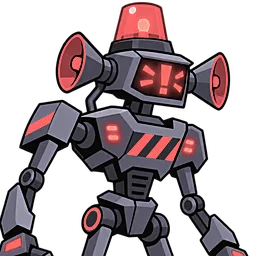<br>**SİREN-6**<br>Alarm | 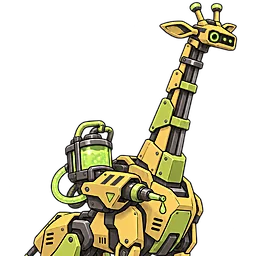<br>**ASİT-6**<br>Arıtma | 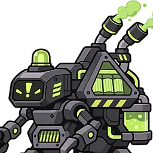<br>**SIZ-7**<br>Atık | 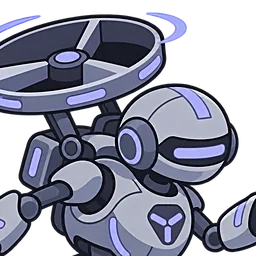<br>**DÖNER-5**<br>Ayırma |

| | | | |
| :---: | :---: | :---: | :---: |
| 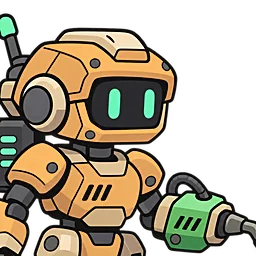<br>**FIX-8**<br>Bakım | 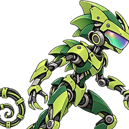<br>**HAYALET-4**<br>Denetim | 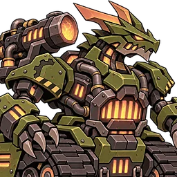<br>**FIRIN-3**<br>Döküm | 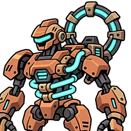<br>**EMP-80**<br>Enerji |

| | | | |
| :---: | :---: | :---: | :---: |
| 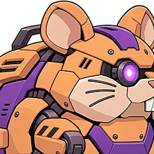<br>**ZIRH-2**<br>Güvenlik | 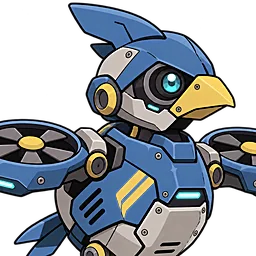<br>**FAN-5**<br>Havalandırma | 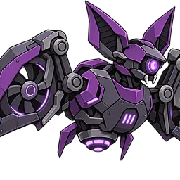<br>**VIZIR**<br>Havalandırma | 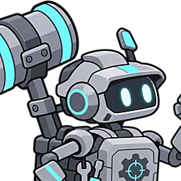<br>**TOK-2**<br>Kalibrasyon |

| | | | |
| :---: | :---: | :---: | :---: |
| 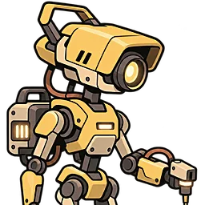<br>**PUNTA-1**<br>Kaynak | 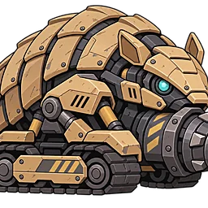<br>**MAT-6**<br>Kazı | 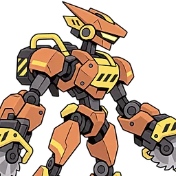<br>**KES-9**<br>Kesim | 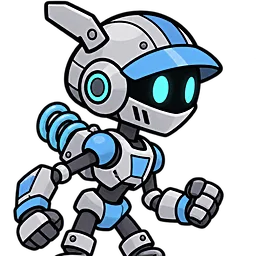<br>**ZIP**<br>Keşif |

| | | | |
| :---: | :---: | :---: | :---: |
| 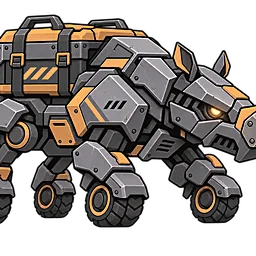<br>**TEK-8**<br>Kurye | 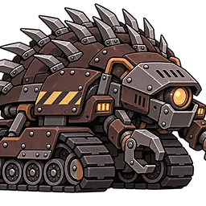<br>**PERÇİN-3**<br>Montaj | 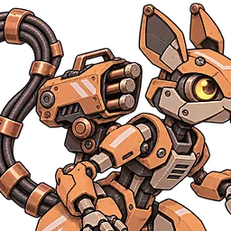<br>**CİV-1**<br>Parça Ayırma | 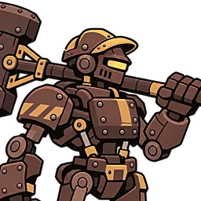<br>**VUR-5**<br>Perçinleme |

| | | | |
| :---: | :---: | :---: | :---: |
| 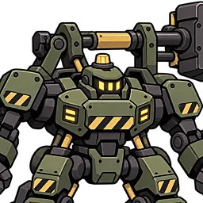<br>**ŞOK-9**<br>Pres | 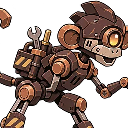<br>**KANCA-4**<br>Raf Bakımı | 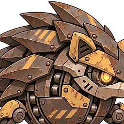<br>**BİLYE-3**<br>Rulman | 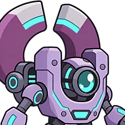<br>**MIK-0**<br>Savunma |

| | | | |
| :---: | :---: | :---: | :---: |
| 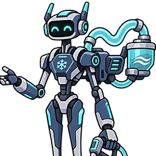<br>**DALGA-2**<br>Soğutma | 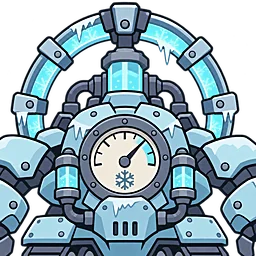<br>**KRİYO-7**<br>Soğutma | 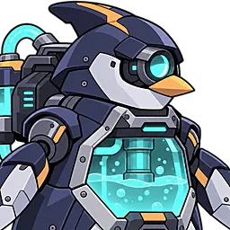<br>**SOĞUT-2**<br>Soğutma | 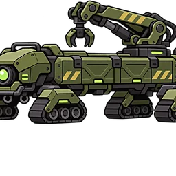<br>**SAP-3**<br>Taşıma |

| | | | |
| :---: | :---: | :---: | :---: |
| 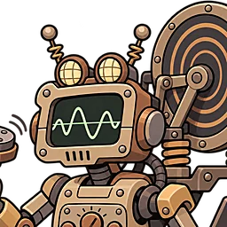<br>**REZ-7**<br>Titreşim | 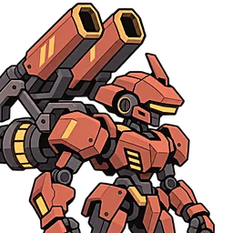<br>**ÇİFT-6**<br>Topçu | 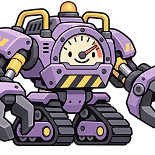<br>**KEPÇE-8**<br>Yükleme | 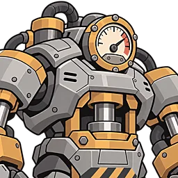<br>**PRES-4**<br>Yükleme |

| | |
| :---: | :---: |
| 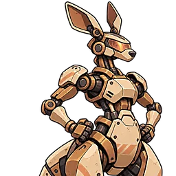<br>**ZIP-X**<br>Yüksek Raf | <br>**BOM-12**<br>Yıkım |


---

## 🛠️ Codebase Architecture

The project emphasizes pristine vanilla engineering without framework bloat:

```
dokumhane-9/
├── index.html           # Canvas stage, HUD layout, and ordered script loader
├── css/style.css        # Clean industrial operations-console UI styling
├── js/
│   ├── game.js          # Main game loop and state machine
│   ├── entity.js        # Robot entity physics, locomotion, and health
│   ├── robots.js        # Modular humanoid robot Canvas renderer
│   ├── weapons.js       # Weapon specifications and projectile parameters
│   ├── projectile.js    # Projectile physics, sub-step sweep, and explosions
│   ├── terrain.js       # Destructible bitmap mask and crater sculpting
│   ├── ai.js            # Ballistic trajectory solver and tactical AI
│   ├── progression.js   # Metagame progression, service levels, and economy
│   ├── profile.js       # LocalStorage schema, migrations, and purchase API
│   ├── market.js        # Shared ammunition inventory and market flow
│   ├── parts.js         # Wearable hardware parts catalog and visual layers
│   ├── audio.js         # Procedural Web Audio API sound synthesizer
│   ├── i18n.js          # Dynamic TR/EN localization engine
│   ├── online-lobby.js  # WebRTC lobby UI and matchmaking flow
│   ├── portal.js        # Poki and CrazyGames SDK bridge
│   └── net/             # P2P protocol, state sync (RLE), and transport
├── tests/               # 1400+ unit and integration tests (pure Node.js)
├── tools/               # Release packaging and asset pipeline scripts
└── art/                 # Concept art, marketing assets, and key illustrations
```

---

## 🧪 Testing & Verification

The repository contains an exhaustive suite of over 1,400 tests running directly on Node.js without third-party test runners:

```powershell
# Run the entire test suite
node tests/run.js

# Specific subsystem tests
node tests/market.js          # Market validation and transaction tests
node tests/progression.js     # Upgrade tiers and reward formulas
node tests/i18n.js            # Translation key parity and catalog integrity
node tests/maps.js            # Map generation and collision mask tests
node tests/audio.js           # Web Audio procedural synthesis check

# Multiplayer and networking tests
node tests/net.js             # Protocol packet serialization
node tests/net-state.js       # State snapshot & RLE terrain sync
node tests/net-integration.js # End-to-end network stack
node tests/net-game.js        # Complete lobby -> match -> victory flow

# Release package verification
node tests/release.js         # Size budgets, script order, and bundle checks
```

---

## 📦 Distribution & Packaging

To generate a standalone, self-contained zip distribution ready for deployment to HTML5 game portals (itch.io, Poki, CrazyGames):

```powershell
# Inspect package contents and size budget (Dry Run)
node tools/build.js --dry

# Build release zip (outputs dist/out-of-warranty-0.6.2.zip)
node tools/build.js
```

The release package must include THIRD-PARTY-NOTICES.md and fonts/LICENSE-*.txt; publish the privacy document at a hosted URL for portal or Steam submissions.

---

## Licenses & Third-Party Notices

The game and repository are proprietary, all rights reserved, as described in the root `LICENSE`; no broader permission is implied. Chakra Petch and Russo One are distributed under the SIL Open Font License (OFL). PeerJS 1.5.4 is MIT licensed and is loaded only for online signalling. CrazyGames and Poki SDKs are loaded only when their matching portal query parameter is present. Artwork in the game includes generated assets, then processed for use in the game; the provenance notes are in `THIRD-PARTY-NOTICES.md`. Include `THIRD-PARTY-NOTICES.md` and `fonts/LICENSE-*.txt` in release packages.

## Privacy & Data

- Settings, locale and the player profile are stored in browser local storage.
- Online lobby uses PeerJS signalling; portal SDKs load only for CrazyGames or Poki builds.
- Diagnostics are copied to the clipboard only when requested; the game sends no diagnostics.
- Play the public browser build at [Out of Warranty](https://bahattinercan.github.io/out-of-warranty/).
- Read [Gizlilik ve Veriler (Türkçe)](./docs/privacy-and-data.md) ([published page](https://bahattinercan.github.io/out-of-warranty/docs/privacy-and-data.html); [English](https://bahattinercan.github.io/out-of-warranty/docs/privacy-en.html)) for storage keys and deletion steps.


---

# Türkçe

## Garanti Dışı Hakkında

**Out of Warranty (Garanti Dışı)**; terk edilmiş bir megafabrikada yedek parçalar için savaşan servis robotlarını konu alan, tarayıcıda çalışan 2B sıra tabanlı taktik topçu oyunudur. Tamamen yıkılabilir araziler, rüzgâr fiziği, 34 oynanabilir robot, atölye ilerlemesi ve WebRTC eşler arası çok oyunculu oyun sunar.

## Hızlı Başlangıç

Kurulum veya derleme gerekmez. `index.html` dosyasını doğrudan açarak başlayın (manuel ilk açılış testi).

## Özellikler

- Yıkılabilir arazi, değişken rüzgâr ve sekiz endüstriyel arena.
- 34 robot, etkin sınıf yetenekleri, 20 silah ve 24 giyilebilir parça.
- Yerel sıcak koltuk çok oyunculu oyun, dört zorluk seviyeli yapay zekâ ve WebRTC çevrimiçi oyun.
- Kodla üretilen Web Audio sesleri; İngilizce ve Türkçe arayüz.

## Kontroller

| Tuş | İşlev |
|:---:|---|
| <kbd>A</kbd>/<kbd>D</kbd> veya oklar | Hareket |
| <kbd>W</kbd> veya yukarı ok | Zıplama |
| Fare | Nişan alma; sol tıkla güç doldurup bırakınca ateş |
| Sağ tık veya <kbd>Esc</kbd> | Atışı iptal etme |
| <kbd>1</kbd>–<kbd>9</kbd> / tekerlek | Silah seçme |
| <kbd>Q</kbd> | Robot yeteneği |
| <kbd>M</kbd> / <kbd>F</kbd> | Sesi kapatma / tam ekran |

## Arenalar

Foundry, Night Crane Yard, Overgrown Reactor, Lunar Debris Yard, Frost Fracture ve Flooded Laboratory arenalarının taktik özellikleri ve görselleri [Arenas bölümünde](#industrial-arenas) gösterilmiştir.

## Silahlar ve Robot Başvurusu

Bazooka sınırsız mühimmatlıdır; diğer mühimmat ve aygıtlar maç içinde sınırlıdır. Hasar ve mühimmat tablosu için [Arsenal & Weapon Specs](#arsenal--weapon-specs) bölümüne, 34 model kodu ve rol için [robot galerisine](#robot-roster-34) bakın.

## Mimari

Oyun saf JavaScript, HTML Canvas ve Web Audio ile çalışır; derleme adımı yoktur. `js/` oyun sistemlerini, `assets/` görselleri, `tests/` denetimleri, `tools/` dağıtım araçlarını içerir.

## Testler

Depoda Node.js tabanlı birim ve bütünleşme testleri bulunur. Çalıştırma yönergeleri [Testing & Verification](#testing--verification) bölümündedir.

## Dağıtım

Portal paketi `node tools/build.js` ile hazırlanır. İlk açılışı doğrulamak için `index.html` dosyasını doğrudan açın. Paket içeriği ve boyut denetimi için [Distribution & Packaging](#distribution--packaging) bölümüne bakın.

## Lisanslar

Oyun ve kaynaklar tüm hakları saklı, tescilli lisans altındadır. Chakra Petch ve Russo One OFL; PeerJS MIT lisanslıdır. CrazyGames ve Poki SDK’ları yalnız ilgili portal bağlamında yüklenir. Ayrıntılar ve paketle birlikte dağıtılacak bildirimler için [Licenses & Third-Party Notices](#licenses--third-party-notices) ile `THIRD-PARTY-NOTICES.md` dosyasına bakın.

## Gizlilik

Yerel kayıt, çevrimiçi sinyalleşme, portal SDK’ları ve tanılama hakkında ayrıntılar: [Gizlilik ve Veri](./docs/privacy-and-data.md).

## Depo Yapısı

`docs/` içinde teknik belgeler ile `privacy-and-data.md` gizlilik açıklaması; kökte `LICENSE` ve `THIRD-PARTY-NOTICES.md`; `fonts/` içinde font lisansları bulunur.

