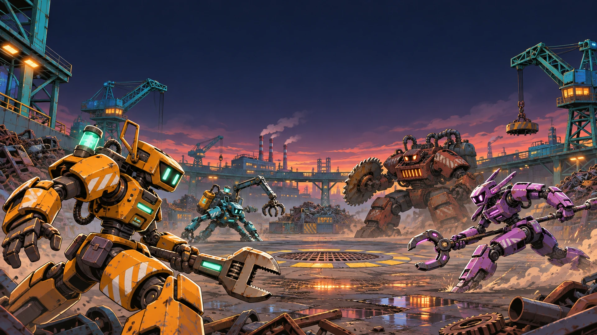

<p align="center">
  
</p>

<h1 align="center">⚙️ Out of Warranty (Garanti Dışı)</h1>

<p align="center">
  <strong>A turn-based 2D tactical artillery game where service robots fight for spare parts in an abandoned megafactory.</strong>
</p>

<p align="center">
  <a href="https://developer.mozilla.org/en-US/docs/Web/JavaScript"></a>
  <a href="https://developer.mozilla.org/en-US/docs/Web/API/Canvas_API"></a>
  <a href="https://developer.mozilla.org/en-US/docs/Web/API/Web_Audio_API"></a>
  <a href="https://webrtc.org/"></a>
  
  
  
  
</p>

---

## 📖 About the Game

**Out of Warranty** is a modern browser-based tactical artillery game inspired by the spirit of classic titles like *Wild Ones* and *Worms*, re-imagined with a gritty industrial robotic aesthetic.

In the abandoned foundries, assembly lines, and cooling plants of a desolate megafactory, discarded maintenance robots clash to secure their warranty and claim scarce spare parts. Featuring fully destructible terrain, dynamic crosswind physics, 34 distinct playable robots with active internal modules, a deep workshop metagame with wearable equipment, and serverless WebRTC peer-to-peer multiplayer.

> [!TIP]
> **Zero Dependencies, Zero Build Step:** The game requires no npm installations, transpilers, bundlers (Vite/Webpack), or external libraries. Double-click `index.html` in your browser and play immediately!

---

## 🚀 Quick Start

No local web server, runtime installation, or compilation is required. The game works out of the box via the `file://` protocol:

```bash
# Windows (PowerShell / Command Prompt)
start index.html

# macOS
open index.html

# Linux
xdg-open index.html
```

Simply open `index.html` in any modern web browser (Chrome, Firefox, Edge, Safari).

---

## ✨ Key Features

- 💥 **Fully Destructible Terrain:** Every explosive impact excavates craters and wears down surface props in real-time with sub-step ray-swept collision detection.
- 🤖 **34 Unique Robots & Class Modules:** Maintenance, defense, scout, courier, casting, and heavy demolition units. Each robot has an active `Q` module with deterministic visual cast effects.
- 🎯 **20 Weapons & Tactical Gadgets:** From standard ballistics and cluster grenades to burrowing drills, bouncy clusters, air strikes, tactical grapple hooks, and teleportation beacons.
- 🛠️ **Workshop & Metagame Progression:** Earn **Scrap** and **Service XP** in matches against AI bots to upgrade Chassis, Attachment, and Core branches.
- 🎛️ **24 Wearable Parts:** Customize your bots with optics, heat sinks, gyroscopes, and booster treads that render dynamically on the humanoid canvas skeleton.
- 🌐 **WebRTC P2P Online Multiplayer:** Serverless, direct peer-to-peer 2–6 player rooms with host-authoritative physics, reconnect tolerance, and room code sharing.
- 👥 **Local Hot-Seat & Smart AI:** Local couch multiplayer for 2–6 players on a single keyboard, or single-player vs. ballistic-calculating AI bots across 4 difficulty tiers.
- 🔊 **Procedural Web Audio Engine:** Zero external audio assets to download. All gunshots, ricochets, explosions, and mechanical hums are synthesized directly in code using the Web Audio API.
- 🌍 **Full Bilingual Support (i18n):** Native Turkish and English translations with zero runtime layout breaks.
- 📦 **Portal Ready:** Built-in SDK bridge for platforms like itch.io, CrazyGames, and Poki.

---

## 🎮 Controls

| Key | Action |
|:---:|---|
| <kbd>A</kbd> / <kbd>D</kbd> or <kbd>←</kbd> / <kbd>→</kbd> | Move robot (steer while airborne) |
| <kbd>W</kbd> or <kbd>↑</kbd> | Jump |
| **Mouse Aim** | Aim weapon angle |
| **Left Click** or <kbd>Space</kbd> | Hold to charge power, release to fire |
| **Right Click** or <kbd>Esc</kbd> | Cancel primed shot |
| <kbd>1</kbd>–<kbd>9</kbd> or **Mouse Wheel** | Select active weapon |
| <kbd>Q</kbd> | Trigger robot's internal skill module |
| <kbd>M</kbd> | Toggle audio mute |
| <kbd>F</kbd> | Toggle full screen |
| In Market: <kbd>1</kbd>–<kbd>5</kbd> | Switch tabs (Ammo, Helmet, Chassis, Attachment, Foot) |
| In Workshop: <kbd>1</kbd> / <kbd>2</kbd> or <kbd>Tab</kbd> | Toggle between UPGRADES and PARTS modes |

---

## 🗺️ Industrial Arenas

Matches take place across 6 hand-crafted industrial arenas with unique tactical layouts:

| Arena | Tactical Environment & Dynamics |
|---|---|
| **Molten Foundry** | Steep outer ramps with a narrow, lethal molten center basin |
| **Night Crane Yard** | Multi-tiered industrial rooftops and high suspended platforms |
| **Overgrown Reactor** | High concrete bunkers flanking a recessed central trench |
| **Lunar Debris Yard** | Low-gravity feel with floating scrap platforms and an uninterrupted lower route |
| **Frost Fracture** | A deadly, bottomless chasm separating two opposing cliff edges |
| **Flooded Laboratory** | Enclosed boundary walls with destructible interior bulkhead barriers |

---

## 💣 Arsenal & Weapon Specs

The primary **Bazooka** has infinite ammunition. Heavy ordnance and tactical gadgets are limited and can be purchased from the Market using Scrap:

| Ammo / Weapon | Damage & Effect | Blast Radius | Base Ammo | Battle Cap |
|---|---|:---:|:---:|:---:|
| **Bazooka** | Standard Ballistic Rocket (46) | 38 | ∞ | ∞ |
| **Grenade** | Timed Fuse Explosive (40) | 46 | 3 | 5 |
| **Sniper** | High-Velocity Armor Piercing (30 + 40 direct) | 16 | 2 | 3 |
| **Shotgun** | 5-Pellet Cone Spread (16 × 5) | 18 | 2 | 4 |
| **Cluster Bomb** | Aerial Fragmentation (28 + 5 × 18 shrapnel) | 30 | 1 | 3 |
| **Triple Rocket** | 3-Rocket Sequential Volley (28 × 3) | 30 | 2 | 4 |
| **Sticky Bomb** | Surface-Adhesive Contact Charge (44) | 44 | 2 | 4 |
| **Bouncy Bomb** | High-Elasticity Ricochet Sphere (34) | 40 | 3 | 6 |
| **Nuke** | Catastrophic Blast & Mega Crater (80) | 84 | 1 | 2 |
| **Drill** | Subterranean Ground-Boring Torpedo (34) | 30 | 2 | 4 |
| **Landmine** | Proximity Sensor Ground Trap (42) | 40 | 2 | 5 |
| **Napalm** | Persistent Incendiary Flame Field (26 + burn) | 30 | 1 | 3 |
| **Teleport Orb** | Utility — Instantly teleports firer to impact site | 12 | 2 | 5 |
| **Grapple Hook** | Utility — Pulls robot to terrain anchor point | 12 | 2 | 5 |

---

## 🤖 Robot Classes & Anatomical Rig

All 34 robots are built on a shared, data-driven modular humanoid Canvas skeleton:

```
[Helmet / Visor] ─── [Face / Diagnostic Display]
       │
   [Chassis] ──────── [Mission Attachment (Weapon / Backpack)]
       │
[Legs / Treads / Mono-wheel / Hover Rotors / Coils]
```

### Featured Models:
- **FIX-8 (Maintenance):** *Emergency Repair* — Welds damaged armor plates to restore HP in the heat of battle.
- **MIK-0 (Defense):** *Polar Barrier* — Projects a magnetic shield that completely neutralizes the next incoming attack.
- **TEK-8 (Courier):** *Turbo Wheel* — High acceleration dash that rams into enemy robots.
- **PRES-4 (Cargo):** *Press Slam* — Deploys a crushing hydraulic press to obliterate adjacent foes.
- **MAT-6 (Excavation):** *Depth Auger* — Bores directly through solid ground to create fortified underground trenches.
- **FIRIN-3 (Smelter):** *Slag Sphere* — Hurls molten slag that covers the terrain in lingering heat.

---

## 🛠️ Codebase Architecture

The project emphasizes pristine vanilla engineering without framework bloat:

```
dokumhane-9/
├── index.html           # Canvas stage, HUD layout, and ordered script loader
├── css/style.css        # Clean industrial operations-console UI styling
├── js/
│   ├── game.js          # Main game loop and state machine
│   ├── entity.js        # Robot entity physics, locomotion, and health
│   ├── robots.js        # Modular humanoid robot Canvas renderer
│   ├── weapons.js       # Weapon specifications and projectile parameters
│   ├── projectile.js    # Projectile physics, sub-step sweep, and explosions
│   ├── terrain.js       # Destructible bitmap mask and crater sculpting
│   ├── ai.js            # Ballistic trajectory solver and tactical AI
│   ├── progression.js   # Metagame progression, service levels, and economy
│   ├── profile.js       # LocalStorage schema, migrations, and purchase API
│   ├── market.js        # Shared ammunition inventory and market flow
│   ├── parts.js         # Wearable hardware parts catalog and visual layers
│   ├── audio.js         # Procedural Web Audio API sound synthesizer
│   ├── i18n.js          # Dynamic TR/EN localization engine
│   ├── online-lobby.js  # WebRTC lobby UI and matchmaking flow
│   ├── portal.js        # Poki and CrazyGames SDK bridge
│   └── net/             # P2P protocol, state sync (RLE), and transport
├── tests/               # 1400+ unit and integration tests (pure Node.js)
├── tools/               # Release packaging and asset pipeline scripts
└── art/                 # Concept art, marketing assets, and key illustrations
```

---

## 🧪 Testing & Verification

The repository contains an exhaustive suite of over 1,400 tests running directly on Node.js without third-party test runners:

```powershell
# Run the entire test suite
node tests/run.js

# Specific subsystem tests
node tests/market.js          # Market validation and transaction tests
node tests/progression.js     # Upgrade tiers and reward formulas
node tests/i18n.js            # Translation key parity and catalog integrity
node tests/maps.js            # Map generation and collision mask tests
node tests/audio.js           # Web Audio procedural synthesis check

# Multiplayer and networking tests
node tests/net.js             # Protocol packet serialization
node tests/net-state.js       # State snapshot & RLE terrain sync
node tests/net-integration.js # End-to-end network stack
node tests/net-game.js        # Complete lobby -> match -> victory flow

# Release package verification
node tests/release.js         # Size budgets, script order, and bundle checks
```

---

## 📦 Distribution & Packaging

To generate a standalone, self-contained zip distribution ready for deployment to HTML5 game portals (itch.io, Poki, CrazyGames):

```powershell
# Inspect package contents and size budget (Dry Run)
node tools/build.js --dry

# Build release zip (outputs dist/out-of-warranty-v0.6.0.zip)
node tools/build.js
```

---

## 📜 License

All rights reserved. Developed as an independent tactical artillery game.  
For technical design documentation and development roadmaps, see the [`docs/`](./docs) directory.
