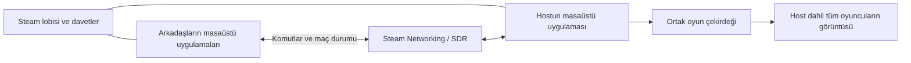

# Dökümhane-9 — Steam Multiplayer Planı

Güncelleme: 8 Ekim 2026. Durum: Planlama; uygulama başlamadı.

Algoritmik inceleme: 8 Ekim 2026. Mimari uygun; aşağıdaki protokol ve yaşam döngüsü kuralları karşı örnekler üzerinden netleştirildi. İnceleme kaydı [multiplayer-algorithm-review.md](./multiplayer-algorithm-review.md) belgesindedir. Çalışan uygulamanın doğruluğu, bu kuralların uygulama testleriyle ayrıca doğrulanmasına bağlıdır.

## 1. Karar ve hedef

Kullanıcının seçtiği yapı: Steam lobileri + Steam arkadaş davetleri + oyuncunun bilgisayarında çalışan yetkili host. Bu belge önceki merkezi Node.js/Socket.IO sunucusu planının yerini alır.

Hedef, arkadaşların farklı bilgisayarlardan aynı sıra tabanlı maça girmesi; ilk tamamlanmış sürüm 2–6 insan oyuncu destekler. Odayı açan oyuncunun masaüstü uygulaması maçın kurallarını yürütür. Diğer oyuncular komut gönderir ve hostun gönderdiği durumu çizer. Steam oyuncuları buluşturur ve ağ trafiğini taşır; simülasyon hostta çalışır.

İlk sürüm için önerilen kapsam:

- Windows x64 masaüstü paketi; Steam açık ve oyuncu hesabı oturum açmış olmalı.
- Arkadaş lobisi, Steam daveti, robot/harita seçimi, hazır durumu, maç, sonuç ve rövanş.
- Taban robot değerleri ve taban mühimmat; çevrimiçi maçlarda profil ödülü yok.
- İlk teknik deneme iki oyuncu, bir harita ve bazuka; içerik tamamlandıktan sonra 2–6 oyunculu sürüm.
- Genel eşleştirme, sıralama, sohbet, seyirci, çevrimiçi bot, host devri ve platformlar arası oyun sonraki kapsam.

## 2. Mimari

Ağ topolojisi yıldız: her misafir hosta bağlanır. Misafirler birbirlerine maç durumu göndermez. Hostun kendi girdisi de diğer oyuncularla aynı komut doğrulamasından geçer.

Yetkili host; hareket, enerji, güç doldurma, mühimmat, mermi/robot çarpışması, hasar, arazi, rüzgâr, modüller, tur süresi ve maç sonucunu hesaplar. Render, ses, fare önizlemesi ve menüler her cihazda yereldir. Arkadaş maçlarında hosta güvenilir; hostun değiştirilmiş oyun koduyla hile yapmasını bu yapı tek başına engellemez. Rekabetçi sıralama bu yüzden ilk kapsamda değildir.

Ayrı kiralık sunucu, alan adı, HTTPS servisi, Socket.IO, veritabanı ve bağımsız hesap sistemi bu sürümün ihtiyaç listesinde bulunmaz. SteamID oyuncu kimliği, Steam lobby ID oda kimliği olur. Kısa oda kodu için ek bir eşleme servisi kurmak yerine Steam daveti ve arkadaş üzerinden katılım kullanılır.

## 3. Masaüstü ve Steam köprüsü: önce teknik doğrulama

Önerilen masaüstü kabuğu Electron. Mevcut HTML/Canvas oyunu renderer içinde çalışır. Steam API ve ağ bağlantıları tek native servis sahibinde, varsayılan olarak ana süreçte tutulur; init/shutdown, callback pompalama ve mesaj alma yalnız burada yapılır. Lobi ve ağ köprüleri aynı Steam SDK oturumunu kullanmalıdır; ayrı bağımlılıkların farklı SDK kopyaları yüklemesi S0'da kontrol edilir. Host simülasyonu saf bir worker içinde yürütülür ve Steam SDK'yi ikinci kez başlatmaz. Native servis ile worker arasında yalnız serileştirilmiş komut/durum mesajları geçer. Worker yalnız sabit adımlı maç saatini yürütür; ana süreç ağ ve pencere yaşam döngüsünü yönetir.

Renderer yalnız sınırlı preload/contextBridge arayüzünü kullanır: oda oluştur/katıl/ayrıl, davet aç, seçim/hazır değiştir, komut gönder ve durum dinle. contextIsolation açık, renderer nodeIntegration kapalı tutulur. Steam köprüsünün örnek kodunun renderer'a geniş Node erişimi vermesi ürün mimarisi olarak doğrudan kopyalanmaz. Steam ağından gelen veri doğrulanır; renderera kod veya dosya yolu olarak aktarılmaz.

Önemli bulgu (8 Ekim 2026): steamworks.js deposunun incelenen client.d.ts dosyası lobi, davet ve callback işlevlerini sunuyor; networking alanında sendP2PPacket/readP2PPacket/acceptP2PSession bulunuyor. Bu yüzey eski ISteamNetworking tarzındadır. Modern ISteamNetworkingSockets desteği mevcut kabul edilmemeli. Paket sürümü ve native uygulama kaynakları uygulama başında ayrıca doğrulanır.

Bu nedenle iki ayrı ihtiyaç değerlendirilir:

1. Lobi, Steam kimliği ve davetler için steamworks.js aday köprü.
2. Maç bağlantısı için modern ISteamNetworkingSockets erişimi. Seçilen sürüm bunu sağlamazsa Steamworks SDK'ye ince Node-API native köprüsü eklenir veya bu API'yi destekleyen doğrulanmış köprü kullanılır. Eski API'ye sessizce dönülmez.

Gerekli modern bağlantı yüzeyi: P2P dinleme/bağlanma, bağlantı durumu callbacki, kabul/kapatma, güvenilir ve güvenilmez gönderme, mesaj alma, uzak Steam kimliği ve bağlantı istatistiği. Örnek SDK işlevleri CreateListenSocketP2P, ConnectP2P, AcceptConnection, SendMessageToConnection ve CloseConnection'dır. Kesin JS arayüzü köprü denemesinde belirlenir.

Native köprü gerekiyorsa Windows derleme araçları ve SDK erişimi ayrıca hazırlanır. Electron/Node ABI uyumu, native binary paketleme, Steam DLL konumu, callback döngüsü ve overlay paketlenmiş exe üzerinde sınanır. Electron ve köprü sürümleri başarılı denemeden sonra kilitlenir; bu belge belirli bir sürümün uyumunu garanti etmez.

**İlk geçiş ölçütü:** iki ayrı Steam hesabı ve bilgisayarla lobi kurma, davetle katılma ve modern Steam bağlantısı üzerinden çift yönlü mesajlaşma. Bu sağlanmadan büyük oyun refaktörüne başlanmaz.

## 4. Mevcut kodun dönüşümü

| Mevcut bölüm | Değişiklik |
|---|---|
| js/game.js — startGame/update/endTurn/atış ve hasar | Saf MatchSimulation ve istemci adaptörü; yeni online mod ve lobi ekranları |
| Game.loop | Görüntü döngüsü; host saati requestAnimationFrame'e bağlı olmayacak |
| js/terrain.js — Uint8Array maskesi ve destroy | Mantıksal maske/oyma ile Canvas boyamasını ayır |
| js/entity.js, js/projectile.js, js/skills.js | Fizik ve kuralları ortak çekirdeğe; çizim/ses/efektleri renderer'a |
| Math.random ile rüzgâr/saçılma/mermi doğuşu | Seed'li oyun RNG'si; dekor RNG'si ayrı |
| js/profile.js ve ilerleme kapıları | Online maçta taban build/mühimmat; yerel profil ödülü verilmez |
| index.html ve js/main.js | Masaüstü bridge algılama; Steam yoksa anlaşılır durum gösterimi |
| tests/ | Saf simülasyon ve sahte taşıma katmanıyla protokol/regresyon testleri |

Tek fizik/kural çekirdeği hem çevrimdışı hem Steam maçında kullanılmalı. İlk ağ denemesi sınırlı içerikle çalışabilir; farklı sonuçlar üreten ikinci bir fizik motoru oluşturulmaz. Mevcut klasik script düzeni adaptörle korunabilir; tüm projeyi framework'e geçirmek bu işin gereği değildir.

Önerilen yeni dosya düzeni:

| Konum | Sorumluluk |
|---|---|
| desktop/main.js | Pencere, Steam başlangıcı, callbackler ve yaşam döngüsü |
| desktop/preload.js | Dar ve doğrulanmış renderer köprüsü |
| desktop/steam/ | Lobi/davet adaptörü ve modern ağ taşıma arayüzü |
| desktop/host-worker.js | Renderdan bağımsız yetkili simülasyon |
| native/steam-networking/ | Yalnız gerekirse modern Steam SDK Node-API köprüsü |
| js/core/ | Saf dünya, arazi maskesi, komutlar, RNG ve snapshot |
| js/net/ | Protokol, host/istemci oturumu, sıra/ack ve eşitleme |
| js/online-lobby.js | Canvas/DOM lobi ekranı ve kullanıcı akışı |
| tests/multiplayer/ | Simülasyon, protokol, eşitleme ve yaşam döngüsü testleri |
| package.json ve paket kilidi | Masaüstü bağımlılıkları ve çalıştırma/paketleme betikleri |

Masaüstü sürümün profil yolu/protokolü file:// web sürümünden farklı olabilir. Tarayıcıdaki mevcut kayıt otomatik taşınmış kabul edilmez. Masaüstü kayıt konumu ve SteamID başına ayrım bu aşamada tanımlanır; gerekiyorsa açık içe aktarım eklenir. Bulut kayıt ayrı kapsamdır.

## 5. Lobi ve oyuncu akışı

1. Ana menü → STEAM İLE OYNA → ODA OLUŞTUR veya ARKADAŞA KATIL. Steam adı kimlikten alınır; ek oyun hesabı gerekmez.
2. Host varsayılan arkadaş lobisi açar; en fazla altı koltuk. ARKADAŞ DAVET ET Steam davet arayüzünü açar.
3. Davet oyun açıkken callbackle, kapalıyken başlangıç argümanıyla ele alınır. Electron ikinci instance isteğini de mevcut pencereye yönlendirir; iki maç süreci açılmaz.
4. Katılan oyuncunun SteamID'si lobi üyeliğiyle karşılaştırılır. Bağlantı isteği yalnız yetkili katılımcı için kabul edilir; aynı kimliğin ikinci bağlantısı kontrollü değiştirilir.
5. Her oyuncu robotunu seçer ve HAZIR der; host haritayı seçer. Her kadro/harita/robot değişikliği lobbyRevision artırır ve bütün hazır onaylarını geçersiz kılar. HAZIR mesajı güncel revision ve seçim hash'ini taşır; eski revision kabul edilmez. Aynı robotun birden fazla oyuncuda seçilmesine mevcut oyuncu renkleriyle izin verilir.
6. Host en az iki bağlı ve aynı revision için hazır oyuncuyla başlatır. Kadro ve maç ayarları kilitlenir; yükleme için benzersiz startAttemptId ve matchId üretilir. Herkes aynı başlangıç snapshotId/hash için LOADED gönderir. Onaylar tamamlanmadan simülasyon ilerlemez; ardından güvenilir START ve tick-0 durumu gönderilir. Önerilen 15 saniyelik yükleme süresi aşılırsa veya kadro değişirse başlangıç iptal edilip lobiye dönülür. Eski denemenin geç gelen LOADED/START mesajları yeni denemeyi etkileyemez.
7. Maç sırasında yalnız aktif oyuncunun komutları işlenir. Yeni katılım oyun kadrosuna eklenmez; aynı SteamID ile mevcut koltuğa yeniden bağlantı ayrı akıştır.
8. Sonuç ekranı → LOBİYE DÖN → yeniden hazır → RÖVANŞ. Her maç yeni matchId alır.

Lobi metadata'sı yalnız küçük keşif bilgileri taşır: buildVersion, protocolVersion, contentVersion/hash, hostSteamId, phase, mapId ve matchId. Metadata gecikmeli keşif verisidir; yetki ve maçı başlatma kararı güvenilir handshake ve güncel Steam üyeliği/sahipliğiyle doğrulanır. Can, fizik veya arazi lobi metadata'sına/chat mesajlarına sürekli yazılmaz; bunlar maç bağlantısından aktarılır. Host hazır ve seçim bilgisinin yetkili kopyasını tutar; bridge eksik member-data API'si sunarsa bu bilgiler güvenilir maç mesajıyla gönderilir.

Sürüm uyuşmazlığı başlangıçtan önce gösterilir. Steam yoksa/başlatılamıyorsa çevrimiçi bölüm durum mesajı verir; mevcut çevrimdışı modlar kullanılabilir. Steam Offline Mode üzerinden internet multiplayer varsayılmaz.

## 6. Maç saati ve komutlar

Host 60 sabit simülasyon adımı/saniye hedefler; durum yayını başlangıçta 15–20/saniye. Durum yayını fizik adım sayısını değiştirmez. Simülasyon için dt=1/60 sabittir; 25 saniyelik normal tur 1500 AIMING adımıdır. Yerçekimi, yürüyüş, 0.012/adım güç artışı, fitiller ve SETTLE sayaçları mevcut 60 Hz birimleriyle taşınır; dt ile tekrar çarpılarak yanlış ölçeklenmez. Render döngüsü maç kurallarını ilerletmez.

Monoton saat ve biriktirici kullanılır. Başlangıç sınırları: bir uyanışta en fazla 8 telafi adımı; kalan borç bir sonraki uyanışa taşınır, sessizce atılmaz. 250 ms'den fazla simülasyon borcu veya uyku sonrası büyük zaman sıçraması hostta kontrollü ABORT üretir. Bu sınırlar ölçümle değiştirilebilir; eşik aşılırken eski turda sınırsız komut işleme yapılmaz. Komutların hosttaki alım zamanı kaydedilir; telafi sırasında geçmiş adımlara geriye dönük girdi uygulanmaz. Aynı adım için komutlar alım sırasıyla, hostun kendi komutları da aynı kuyrukta işlenir. Tur bitiş sınırında yalnız hosta sınırdan önce ulaşmış geçerli komutlar ele alınır; ardından zaman aşımı bir kez uygulanır. Yeniden oynatma günlüğü yalnız seed ve ham paketlerden değil, kabul edilmiş komut + uygulanmış tick/sıra bilgisinden oluşur.

Misafirler snapshotlar arasında görüntüyü yumuşatır. İlk sürümde yetkili yerel fizik tahmini yoktur; nişan/güç göstergesi anlık önizleme yapabilir, hosttan gelen sonuçla düzeltilir. Host ve misafir hissi farklılaşırsa istemci tahmini sonraki ölçüme bağlı iyileştirmedir.

Mesaj zarfı: protocolVersion, lobbyId, authoritySessionId, matchId, turnId ve akışa uygun commandId/sequence. authoritySessionId, host her oturum oluşturduğunda değişen benzersiz kimliktir; matchId süreç içi sayaçla sınırlanmaz. Bağlantı değişince connectionGeneration artar, eski bağlantının kuyrukta kalan paketleri reddedilir. Gönderen kimliği paketin id alanından değil Steam bağlantısının uzak kimliğinden alınır. Misafir yalnız handshake'te doğruladığı hostSteamId + authoritySessionId'den maç durumu kabul eder. SteamID/lobby ID, JS Number yerine string veya BigInt olarak işlenir; JSON sınırında string kullanılır.

Komutlar: hareket yönü, sıçrama, nişan açısı/hedef koordinatı, silah seçimi, güç doldurmayı başlat/iptal et/bırak, modül kullan. Güç artışını ve sınırını host hesaplar. CHARGE_BEGIN benzersiz chargeId üretir; tekrar BEGIN gücü sıfırlamaz. RELEASE/CANCEL bu kimliğe bağlıdır; kapanmış chargeId ikinci kez kullanılamaz. Güvenilir tek seferlik eylemler tek sıralı eylem akışında gönderilir. RELEASE; weaponId, son nişan açısı ve hedefX gibi atış anındaki gerekli değerleri atomik taşır. Host bu alanları doğrulayıp atışa uygular; son güvenilmez nişan paketinin gelmesini beklemez. Bomba Yağmuru mevcut fireAirdrop'ta mouseX kullandığı için hedefX zorunludur. Yön kullanan modül komutu da kendi son nişanını taşır.

Hareket ve nişan güncel değerler olarak, değişmese bile örneğin 20 Hz girdi yenilemesiyle gönderilir. Hareket sequence'i ile güvenilir eylem sequence'i ayrı tutulur; biri diğerinin geçerliliğini silmez. Eski hareket paketleri biriktirilmez. Girdi yenilemesi 500 ms kesilince hareket sıfırlanır ve güç doldurma iptal edilir; genel bağlantı heartbeat'i bunun yerine geçmez. Tur değişimi, oyuncunun elenmesi ve kopma da girdiyi sıfırlar. Basılı hareket işareti doğrudan walk çağrısı değildir; yürüyüş yalnız simülasyon adımı içinde uygulanır.

Host her komutta üyelik/koltuk, aktif sıra, maç aşaması, enerji, cooldown, mühimmat, sayı sınırları ve mesaj boyutunu denetler. NaN/Infinity, bilinmeyen kimlik/silah, geçmiş tura ait komutlar ve aşırı gönderim reddedilir. Sıra: kimlik/zarf kontrolü → önceki commandId sonucunu arama → yeni komutta kural kontrolü → adım sınırında atomik uygulama → sonucu/uygulanan tick'i kaydetme → ACK. Böylece başarılı atıştan sonra PROJECTILE'a geçilmiş olsa da yinelenen komut önceki başarı ACK'ini alır. Aynı kimlik farklı payload ile gelirse protokol hatasıdır. Sonuç cache'i bağlantıdan bağımsız oyuncu+authoritySessionId+matchId kapsamındadır; kapanmış tur için yüksek sequence sınırı/tombstone tutulur. Cache sınırlı olsa da unutulmuş eski komut yeniden uygulanmaz.

Taşıma tasarımı:

- Güvenilir mesajlar: başlangıç, seçim/hazır, atış/modül/sıçrama gibi tek seferlik komutlar, komut onayı, tur geçişi, hasar/sonuç, arazi değişiklikleri ve kurtarma snapshotları.
- Güvenilmez mesajlar: güncel hareket/nişan ve periyodik konum/görsel durum. Sequence ile eski paket elenir; bir sonraki paket kaybı telafi eder.
- Tam snapshot ve arazi aktarımı parçalanır, boyut sınırı ve hash taşır. Büyük güvenilir aktarım, anlık güncellemeleri sürekli bloke etmeyecek şekilde zamanlanır; kanal/lane desteği köprüye göre doğrulanır.
- Güvenilir taşıma uygulama düzeyinde tam bir kez işleme sağlamış kabul edilmez; bağlantı yenileme ve komut tekrarları yine tekilleştirilir.

### 6.1. Durum makinesi ve değişmezler

Oturum durumu: DISCONNECTED → LOBBY → LOADING → PLAYING → RESULTS → LOBBY. LOADING/PLAYING'den ABORT ile LOBBY'ye dönülebilir. RESYNC, bağlantısı yeniden kurulan tek istemcinin alt durumudur; hostu veya bütün maçı durdurmaz. Maç çekirdeğinde AIMING → PROJECTILE → SETTLE → AIMING/GAMEOVER; atış harcayan modül ve tur zaman aşımı mevcut kurallara göre SETTLE'a da geçebilir.

Korunacak değişmezler:

1. Her matchId için bir yetkili host, sabit oyuncu/entity kimlikleri ve tek aktif tur vardır.
2. Atış tüketen eylem başarılı olduğunda AIMING atomik olarak kapanır; aynı adımda ikinci atış/modül reddedilir. Atış harcamayan modüller kalan enerji/cooldown kurallarıyla devam eder.
3. Ağ paketini almak fizik ilerletmez; hareket, hasar, fitil ve tur süresi yalnız simülasyon adımıyla ilerler.
4. RELEASE/CANCEL bir chargeId'yi yalnız bir kez kapatır. Düşman/elenmiş/RESYNC oyuncunun girdisi uygulanmaz.
5. Tur bitişi eski turnId için bir kez işler; cooldown, zehir, enerji yenileme ve rüzgâr sayacı çift uygulanmaz. GAMEOVER/ABORT terminaldir; sonradan gelen komut maçı canlandıramaz.
6. Geçici bağlantı kaybı ile robotun alive alanı ayrı durumlardır; kopan oyuncu grace süresince fizik/hasardan etkilenmeye devam eder.
7. terrainVersion yalnız uygulanan arazi değişimiyle ilerler. snapshotSeq sıçrayabilir; eventId/commandId kimlikleri tekrar uygulamaya yol açmaz.
8. Yükleme/kurtarma yalnız aynı otorite, maç, snapshot kimliği ve doğru hash için onaylanır; ağ üzerinden constructor veya render işlevi yeniden çalıştırılmaz.

## 7. Arazi ve tam durum eşitleme

Tam durum; robotların konum/hız/can/enerji/mühimmatını, modül cooldown/etkilerini, tur/süre/rüzgârı, oyun RNG durumunu, mermileri, mayınları, napalm alanlarını, kancayı ve sonucu içerir. Nesne referansları ve Set alanları sabit kimlik dizileri olarak serileştirilir.

Harita başlangıcı: harita kimliği, sabit dünya boyutu, içerik hash'i, görsel seed ve sıkıştırılmış tam çarpışma maskesi. Sonra hostun sıralı terrainVersion taşıyan oyma/değişim kayıtları gönderilir. Matkap gibi sık oymalar paketlenir; her kare tüm maskeyi aktarmak yerine değişiklik yayını yapılır.

Hostun RNG'si oyun sonucunun kaynağıdır; dekor rastgeleliği onu tüketmez. Tüm cihazlarda aynı fiziğin bağımsız yürütülmesine dayanan lockstep zorunlu değildir.

Periyodik durum yayını ilk sürümde delta yerine küçük fakat bağımsız tam dinamik durum taşır: snapshotSeq/serverTick, terrainVersion ve eventHighWater. snapshotSeq atlaması güvenilmez taşıma için normaldir; daha yeni tam durum eskisini değiştirir, sırf boşluk var diye kurtarma istenmez. Arazi ise delta akışıdır: baseTerrainVersion tam olarak uygulanmış sürüme eşit olmalıdır. Eksik arazi delta'sı varsa sınırlı tampon ve tekrar isteği kullanılır; süre/kapasite aşımında veya maskenin hash'i uyuşmazsa tam kurtarma yapılır. Dinamik snapshot arazi henüz yetişmediğinde uygulamaya alınmaz; terrainVersion bağımlılığı tamamlanana kadar tamponlanır. Turlar arası yumuşatma sıfırlanır; ışınlanma/elenme normal konum interpolasyonu olarak çizilmez.

Kurtarma snapshotı tek adım sınırında değişmez kopya olarak alınır: snapshotId, serverTick, terrainVersion, eventHighWater ve komut sonuç sınırı birlikte kaydedilir. Parçalar aynı snapshotId, parça indeksi/adedi ve toplam hash taşır; farklı snapshotlar karıştırılmaz. Aktarım boyunca sonraki güvenilir olay/delta'lar sınırlı tamponlanır; snapshot sınırından eski olanlar atılır, yenileri sırayla uygulanır. Tampon taşarsa daha yeni snapshot istenir. LIVE onayı ve yeni girdi durumu gelene kadar ilgili oyuncunun girdisi kilitli kalır; host diğer oyuncular için devam eder. Snapshotla temsil edilmiş eski hasar/efekt olayları yeniden uygulanmaz; olaylar eventId ile tekilleştirilir. İlk bağlantı ve yeniden bağlanma aynı sözleşmeyi kullanır.

Wire şeması doğrudan Game/Entity nesnelerinin JSON.stringify sonucu değildir. Bazuka mühimmatı çekirdekte Infinity olabilir; ağda açık bir unlimited etiketi veya katalogdan türetilen sınırsız tür taşınır. null ile sınırsızlık kodlanmaz; tüm koordinatlar/hızlar sonlu sayıdır. Terrain maskesi byte dizisi olarak, Set ve referanslar sabit entityId listeleri olarak aktarılır. Kalıcı oyuncu dizisi maç boyunca splice edilmez; slot ve entityId değişmez.

İstemci görüntü snapshotı ile simülasyonu sürdürmek için kullanılan checkpoint şeması ayrılır. Checkpoint; yukarıdakilere ek olarak shotMod/shotIsSkill, shooterEntityId, windTurnsRemaining, settleTicks, aktif charge/girdi lease'i, projectile spec kimliği/fitil/bölünme ve matkap bütçesi, mine owner/arm, fire ömrü/hasar sayacı, kanca durumu, pending elimination ve komut tekilleştirme sınırlarını kapsar. İçerik hash'i doğrulanmış katalogdan spec'ler yeniden kurulur. Her davranış ailesi için devam sonucu testi olmadan şema tam kabul edilmez.

## 8. Kopma, host kaybı ve oda yaşam döngüsü

**Misafir koparsa:** girdi temizlenir, koltuk hostun monoton saatinde 60 saniye ayrılır; host normal tur zamanını sürdürür. Süreyi yalnız host belirler. Steam lobi üyeliği devam ediyorsa doğrudan yeniden bağlantı, lobiden düşmüşse yeniden katılım ve kayıtlı SteamID/koltuk kontrolü kullanılır. Bu desteği vermek için maçta SetLobbyJoinable(false) çağrılmaz; Steam davetli eski oyuncuyu da engeller. Kadro kilidi uygulama katmanındadır. Yeni lobby üyesine MATCH_IN_PROGRESS gösterilir; slot verilmeyip lobiden ayrılması istenir ve maç bağlantısı reddedilir. Steam lobby kapasitesi en fazla altıdır; ayrılan oyuncunun boş yerini yeni oyuncu kısa süre işgal ederse eski oyuncu süre içinde yeniden dener, garantili kapasite rezervasyonu Steam'de varsayılmaz. Süresi geçmiş koltuk aynı SteamID gelse de o maçta canlandırılmaz. Kopan oyuncunun güç doldurması iptal edilir.

60 saniye bitince elenme pendingElimination olarak işaretlenir ve ilk güvenli tur geçişinde uygulanır. PROJECTILE/SETTLE sırasında oyuncu dizisi/owner referansları silinmez, uçan salvo yarıda yok edilmez. Kasıtlı ayrılmada da aynı güvenli sınır kuralı uygulanır; kopma süresi tanınmaz. Hasarla elenme mevcut kuralları izler. Elenme/zehir/tur sonu etkileri ve yaşayan sayısı tek geçiş içinde birlikte değerlendirilir; GAMEOVER bir kez üretilir. Aktif oyuncunun süresi bittiyse yeni girdi kabul edilmez, AIMING'den kontrollü SETTLE'a geçilir. Host dışındaki oyuncuların tamamı ayrıldıysa maç güvenli sınırda iptal edilip lobiye dönülür.

**Host bağlantısı kaybolursa:** yalnız bağlantısı etkilenen misafir girdiyi kilitler; host ve bağlı diğer oyuncular maçı sürdürür. 10 saniye ilk otomatik tekrar denemesinin UI süresidir; başarısız olunca bağlantı kesildi ekranı gösterilir, bu tek başına bütün maçı iptal etmez. Aynı host/authoritySessionId/matchId için hostun tanıdığı 60 saniyelik koltuk penceresinde tekrar denenebilir. İstemci yerel saate bakarak kazanan veya global ABORT kararı üretmez. Açık host ABORT, hostun Steam lobisinden doğrulanmış ayrılması ya da yeni sahip için yeni authoritySessionId ilanı eski maçı kapatır. Host çökmesi henüz doğrulanamıyorsa süre sonunda istemci yerel oturumu bırakıp menüye/lobi durumuna döner; bunu hostun bütün oyunculara onayladığı maç sonucu gibi kaydetmez. V1 geçici ağ bölünmesinde bütün ekranların aynı anda sonlanacağını garanti etmez; yeni maç handshake'i eski oturumu kesin olarak ayırır.

**Lobide host ayrılırsa:** Steam yeni lobi sahibi atayabilir. Yeni sahibi yeni authoritySessionId ile boş maç oturumu oluşturur; hazır durumları sıfırlanır ve host kimliği metadata'da yenilenir. Başlangıç yüklemesi sırasında host değişirse başlangıç iptal edilir. Devam eden maçta otomatik lobi sahibi değişikliği simülasyon devri sayılmaz; eski matchId iptal edilip yeni host yeni maç başlatabilir. Güncel sahip değişikliği doğrulanınca eski otoritenin bütün paketleri reddedilir; eski host da sahipliği kaybettiğini görünce simülasyonu kapatır. Sadece yeni bağlantı kayboldu diye başka oyuncu kendini host ilan edemez.

**Steam bağlantısı kesilirse:** mevcut P2P bağlantısının hemen koptuğu varsayılmaz. Lobi/davet işlemleri başarısız gösterilir, maç bağlantısının kendi sağlık durumu izlenir. Kopma zaman aşımı bağlantı sinyaline/heartbeat'e dayanır; Steam erişimi dönene kadar yeni oda/katılım denemesi açık hata verir.

Hostun kendi çıkış/menü akışı maç iptal mesajını gönderir; sınırlı ACK bekleme/flush süresinden sonra bağlantıları kapatıp lobiden ayrılır. Son mesajın ulaşması kesin kabul edilmez; ayrılma/sahip değişikliği kontrolü yedektir. Hostun oyundan elenmesi, maçı barındırmayı bırakması anlamına gelmez.

Host devri v2 kapsamıdır: düzenli kurtarma checkpointleri, yeni host seçimi, RNG ve tüm kalıcı etkilerin devamı, epoch ile eski host paketlerinin reddi ve bölünmüş oturum önleme gerekir. Yalnız yeni lobi sahibini okumak yeterli değildir.

## 9. Steam hazırlıkları ve maliyet

- Hedef dağıtım için Steamworks uygulaması/AppID, SDK erişimi, Windows build/depot, test hesaplarının aynı uygulamaya erişimi ve test dalı gerekir. Bunların mevcut olduğu henüz doğrulanmadı.
- Paketlenen arkadaş testleri iki farklı Steam hesabı ve iki bilgisayarla yürütülür. Tek hesabın iki oyun penceresi gerçek Steam multiplayer testi yerine geçmez.
- SDK örnek AppID'si ilk laboratuvar denemesinde kullanılabilir; arkadaş dağıtımı/ürün testi gerçek uygulama erişimiyle yapılır. Test AppID dosyası üretim paketine yanlışlıkla taşınmaz.
- Steam lobileri ve Steam networking kullanılarak ayrı aylık oyun sunucusu kiralamadan bu mimari kurulabilir. Hostun bilgisayarı, interneti ve erişilebilir kalması işletme kaynağıdır.
- Steam Direct uygulama ücreti dağıtım planındaki ayrı giderdir; sunucu kirasıyla aynı şey değildir. Güncel ücret bağlantısı aşağıdadır. Bu plan sınırsız relay kapasitesi veya koşulsuz hizmet garantisi varsaymaz.
- Paket; yalnız oyun dosyaları, masaüstü kabuğu, gerekli native modüller ve Steam runtime dosyalarını içerir. Geliştirme probe'ları, testler ve SDK'nin tamamı dağıtım listesine alınmaz.
- Steam Pipe güncellemeleri ve kontrollü beta dalı kullanılır. Bu sürüm için ayrı Electron otomatik güncelleme servisi kurulmaz.

## 10. Aşamalar ve geçiş ölçütleri

| Aşama | İş | Tamamlanma ölçütü |
|---|---|---|
| S0 — Steam bağlantı denemesi | Electron exe, Steam kimliği, lobi, açık/kapalı uygulamada davet ve modern P2P köprüsü | İki hesap/iki PC farklı ağlarda çift yönlü mesajlaşır; seçilen sürüm ve köprü belgelenir |
| S1 — Ortak çekirdek | DOM/Canvas/sesten ayrılmış simülasyon, arazi maskesi, seed'li RNG, komut/checkpoint ve durum makinesi | Node'da maç ilerler; checkpoint devamı eşleşir; Infinity wire şeması, tekilleştirme ve terminal geçişler doğrulanır; mevcut testler korunur |
| S2 — İlk ortak maç | İki oyuncu, tek arena, yürüyüş/sıçrama ve bazuka; host worker/istemci adaptörü | İki PC tek maçı bitirir; atomik nişan/atış, kayıplı durum yayını ve basit kopma/host iptali tutarlıdır; minimize etmek saati durdurmaz |
| S3 — Arkadaş lobisi | Seçim, hazır, 2–6 koltuk, yükleme onayı, sonuç/rövanş | 2, 3 ve 6 oyunculu akış; dolu oda, sürüm farkı ve lobi sahibi değişimi doğrulanır |
| S4 — İçerik tamamla | 34 robot/harita ve tüm silah/modüller; mayın, napalm, kanca, ışınlanma | Veri kapsamı taranır ve davranış aileleri çevrimiçi senaryolarla doğrulanır |
| S5 — Dayanıklılık ve his | Önceki aşamalardaki protokol kurallarını bütün içerikle stresle; parçalı snapshot, yeniden bağlanma, bant/latans ölçümü | Gecikme/kayıp/kopma ve host çıkışında anlaşılır sonuç; kontrol hissi arkadaş testinde kabul edilir |
| S6 — Steam arkadaş betası | Gerçek AppID ve test erişimiyle paket/dal; farklı ağlarda maçlar | 2 ve 6 oyunculu tam maç ve rövanş; kapalı oyuna davet, overlay ve yeniden katılım doğrulanır |

İlk teslim hedefi S0–S2'dir: Steam'den davet edilen iki arkadaşın farklı bilgisayarlarda aynı bazuka maçını tamamlaması. S0 başarısızsa önce masaüstü/native köprü sorunu çözülür; oyun refaktörüne tahmine dayanarak devam edilmez.

## 11. Doğrulama ve ölçüm

Bu güncelleme yalnız plan belgelerini değiştirir; aşağıdaki testler uygulama sırasında yapılacaktır.

- Başlangıç regresyonu: node tests/run.js, tests/progression.js, tests/market.js, tests/audio.js ve tests/maps.js; varsa önceden var olan hatalar kaydedilir.
- Çekirdek: aynı seed/komut aynı sonuç; tam durum serileştir/yükle/devam sonucu kesintisiz koşuyla eşleşir.
- Protokol: yinelenen atış tek tüketim, yanlış oyuncu/eski tur reddi, bozuk sayılar, aşırı mesaj, sürüm ve içerik farkı.
- Atomik eylem: son nişan paketi kayıp/gecikmişken RELEASE kendi açısıyla ateşler; Bomba Yağmuru kendi hedefX'ini kullanır. CHARGE_BEGIN/RELEASE tekrarı güç/mühimmatı çift değiştirmez; başarılı atışın geç ACK'i sonraki tur komutuna karışmaz.
- Durum sürümleri: snapshotSeq 10 → 13 normal kayıpta kurtarma başlatmaz; terrain delta v10 → v12 ise eksik v11 tamamlanmadan uygulanmaz. Farklı lane'lerden olay/snapshot ters sırada geldiğinde hash ve durum doğru kalır.
- Başlangıç bariyeri: eski lobbyRevision/startAttemptId LOADED mesajı yeni maçı başlatamaz; herkes yüklemeden fizik/tur süresi ilerlemez.
- Checkpoint: sınırsız bazuka JSON'da null olmaz; zehir, rüzgâr kalan turu, mermi fitili, shotMod, mayın sahibi ve SET alanlarıyla salvo ortasında devam sonucu eşleşir.
- Yaşam döngüsü karşı örneği: tek misafir hosta ulaşamazken diğerleri bağlıdır; o misafir global maç iptali üretemez. Yeni otorite ilanından sonra eski host paketi ve eski bağlantı komutu reddedilir. Misafir grace süresi salvo ortasında dolunca owner/slot kimlikleri kaymaz.
- Sahte taşıma: paket kaybı/sıra değişimi/tekrar/gecikme; arazi delta boşluğu tam durumla kurtarılır. Native bağlantı ayrıca gerçek Steam testinde doğrulanır.
- Özel davranışlar: çoklu/parçalanan mermi, matkap, mayın, napalm, kanca, ışınlanma, kalkan ve farklı tur tüketen modül aileleri.
- Yaşam döngüsü: host elenmesi, host menüye dönmesi/çökmesi/uykusu, lobi sahibi değişimi, misafir kopma/yeniden başlatma, yükleme sırasında ayrılma, Steam bağlantı kaybı.
- Paket: temiz Windows makinesinde kurulum/açılış, native DLL, Steam overlay, uygulama kapalıyken davet, farklı ekran ölçekleri ve ses.
- Gerçek ağ: 100–250 ms gecikme ve kayıp senaryoları; farklı internet bağlantılarından 2/6 oyunculu maç. Host CPU/adım süresi, ping, gönderilen byte/s, en büyük snapshot ve yeniden eşitleme süresi ölçülür. Sayısal performans hedefleri S2 ölçümünden sonra belirlenir.

## 12. Sonraki sürümler

Öncelik sırası: host devri → ölçümlere göre hareket tahmini/gecikme iyileştirmesi → genel oda listesi/bot desteği → Steam başarımları/bulut kayıt → ihtiyaç varsa dedicated server veya diğer platform taşıması. Bağımsız tarayıcı multiplayerı ek bir ağ/kimlik hizmeti gerektirebilir; mevcut Steam kapsamının parçası değildir.

## 13. Teknik kaynaklar

Kontrol tarihi: 8 Ekim 2026. Mimari kararlar bu projenin planıdır; aşağıdaki bağlantılar platform davranışları ve aday araçlar için kaynaklardır.

- [Steam Networking](https://partner.steamgames.com/doc/features/multiplayer/networking): modern ağ API'leri ve host üzerinden trafik modeli.
- [Steam Datagram Relay](https://partner.steamgames.com/doc/features/multiplayer/steamdatagramrelay): Steam P2P relay kullanımı ve platform koşulları.
- [Steam lobileri](https://partner.steamgames.com/doc/features/multiplayer/matchmaking): keşif ve lobi akışı; oyun ağı ayrıca gerekir.
- [ISteamMatchmaking](https://partner.steamgames.com/doc/api/ISteamMatchmaking): sahip değişimi ve açık/kapalı uygulamada davet işleme.
- [ISteamNetworkingSockets](https://partner.steamgames.com/doc/api/ISteamNetworkingSockets): modern P2P bağlantı yüzeyi.
- [steamworks.js deposu](https://github.com/ceifa/steamworks.js) ve [API bildirimleri](https://raw.githubusercontent.com/ceifa/steamworks.js/main/client.d.ts): aday JS köprüsü; modern ağ kapsamı doğrulanmalıdır.
- [Electron güvenlik modeli](https://www.electronjs.org/docs/latest/tutorial/security): preload, contextIsolation ve IPC sınırları.
- [Steam Direct ücreti](https://partner.steamgames.com/doc/gettingstarted/appfee): dağıtım uygulama gideri.
