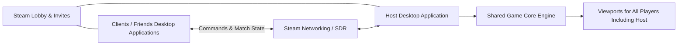

# Dökümhane-9 — Steam Multiplayer Plan

Updated: October 8, 2026. Status: Planning; implementation has not started.

Algorithmic review: October 8, 2026. Architecture is sound; the protocol and lifecycle rules below have been clarified using counterexamples. The review log can be found in [multiplayer-algorithm-review.md](./multiplayer-algorithm-review.md). Correctness of the running implementation depends on separate verification of these rules via implementation test suites.

## 1. Decision and Goal

User-selected architecture: Steam lobbies + Steam friend invites + authoritative host running on the player's machine. This document supersedes the earlier centralized Node.js/Socket.IO server plan.

The goal is to allow friends on different computers to join the same turn-based match; the initial complete release supports 2–6 human players. The desktop application of the player hosting the room executes match rules. Other players send input commands and render the state broadcast by the host. Steam handles player matchmaking/discovery and transports network traffic; the simulation runs on the host.

Recommended scope for the initial release:

- Windows x64 desktop package; Steam running and player account signed in.
- Friend lobby, Steam invites, robot/map selection, ready status, match execution, results, and rematch.
- Base robot stats and base ammunition; no profile progression rewards in online matches.
- Initial technical trial: two players, one map, and bazooka; full 2–6 player release once content is wired.
- Public matchmaking, ranking/leaderboards, chat, spectators, online bots, host migration, and cross-platform play deferred to future scope.

## 2. Architecture

Network topology is star: every guest connects to the host. Guests do not send match state to each other. The host's own local inputs pass through the identical command validation pipeline as remote players.

The authoritative host calculates movement, energy, power charging, ammunition, projectile/robot collisions, damage, terrain destruction, wind, modules, turn timers, and match results. Rendering, audio, mouse trajectory previews, and menus are purely local to each client machine. In friend matches, the host is trusted; this architecture alone does not prevent a host with modified client code from cheating. For this reason, competitive ranking is explicitly excluded from the initial scope.

No separate rented dedicated servers, domain names, HTTPS endpoints, Socket.IO daemons, databases, or third-party account systems are required for this release. SteamID acts as player identity, and Steam lobby ID acts as room identity. Rather than hosting an auxiliary short room-code mapping service, Steam invites and join-via-friend are utilized directly.

## 3. Desktop and Steam Bridge: Technical Validation First

Recommended desktop shell is Electron. The existing HTML/Canvas game runs inside the renderer process. Steam API and network connections reside in a single native service owner, by default in the main process; initialization/shutdown, callback polling, and message dispatching happen exclusively here. Lobby and networking bridges must share the same Steam SDK session; ensuring distinct dependencies do not load separate SDK runtime instances is verified during Phase S0. The host simulation runs inside a clean worker thread and never initializes the Steam SDK a second time. Only serialized command/state messages pass between the native service and worker. The worker exclusively drives the fixed-step match clock; the main process handles networking and OS window lifecycles.

The renderer only accesses a strictly constrained preload/contextBridge interface: create/join/leave room, open invite dialog, change selection/ready, dispatch command, and subscribe to state snapshots. `contextIsolation` remains enabled, and renderer `nodeIntegration` remains disabled. Sample bridge code providing broad Node filesystem access to the renderer must not be replicated in production architecture. Data arriving from the Steam network is validated; it is never passed to the renderer as executable code or file paths.

Key finding (October 8, 2026): The inspected `client.d.ts` in the `steamworks.js` repository exposes lobby, invite, and callback functions; under networking it exposes `sendP2PPacket`/`readP2PPacket`/`acceptP2PSession`. This surface corresponds to legacy `ISteamNetworking`. Native `ISteamNetworkingSockets` support must not be assumed out of the box. Package version and native implementation sources must be verified at implementation kick-off.

Therefore, two separate requirements are evaluated:

1. `steamworks.js` as candidate bridge for lobby, Steam identity, and invites.
2. Modern `ISteamNetworkingSockets` access for match communication. If the selected package version lacks it, a lightweight Node-API native bridge to the Steamworks SDK will be written or an authenticated wrapper supporting this API will be used. Silent fallback to obsolete networking APIs is prohibited.

Required modern networking API surface: P2P listen/connect, connection state change callbacks, accept/close connection, reliable and unreliable packet dispatch, message reception, remote SteamID retrieval, and connection link telemetry. Example SDK primitives include `CreateListenSocketP2P`, `ConnectP2P`, `AcceptConnection`, `SendMessageToConnection`, and `CloseConnection`. Concrete JS interfaces will be finalized in the spike.

If a native bridge is required, Windows C++ build tools and Steam SDK access must be configured. Electron/Node ABI compatibility, native binary bundling, Steam DLL layout, callback loop pumping, and the Steam overlay must be verified on packaged executable builds. Electron and wrapper dependency versions will be locked upon successful trial; this document does not guarantee unverified version pairings.

**Initial Gate Criterion:** Two separate Steam accounts on distinct computers can create a lobby, join via invite, and exchange bidirectional messages over a modern Steam connection. Major game core refactoring will not commence until this gate passes.

## 4. Transforming Existing Code

| Existing Module | Required Modification |
|---|---|
| `js/game.js` — `startGame`/`update`/`endTurn`/firing & damage | Extract pure `MatchSimulation` and client adapter; introduce online mode & lobby screens |
| `Game.loop` | Pure render loop; host clock must decouple from `requestAnimationFrame` |
| `js/terrain.js` — `Uint8Array` mask & `destroy` | Separate logical mask carving from Canvas rasterization |
| `js/entity.js`, `js/projectile.js`, `js/skills.js` | Extract physics and rules to shared core; leave rendering/audio/FX in renderer |
| `Math.random` in wind/spread/projectile spawning | Deterministic seeded gameplay RNG; separate cosmetic RNG |
| `js/profile.js` & progression gates | Fixed baseline build/loadout in online matches; disable local profile rewards |
| `index.html` & `js/main.js` | Desktop bridge detection; explicit offline/error state when Steam is unavailable |
| `tests/` | Headless simulation and mock transport layer testing protocol and regressions |

A single physics and rules core must drive both offline single-player and Steam matches. The initial multiplayer prototype may run with a subset of weapons/arenas, but creating a divergent secondary physics engine is strictly prohibited. The existing script structure can be preserved via adapters; porting the entire codebase to a modern UI framework is unnecessary.

Proposed file structure:

| Path | Responsibility |
|---|---|
| `desktop/main.js` | Window creation, Steam initialization, callback polling, process lifecycle |
| `desktop/preload.js` | Minimal, strictly validated renderer IPC bridge |
| `desktop/steam/` | Lobby/invite adapter and modern network transport layer |
| `desktop/host-worker.js` | Headless, render-decoupled authoritative simulation |
| `native/steam-networking/` | Optional lightweight Steam SDK Node-API wrapper (if needed) |
| `js/core/` | Pure world model, terrain mask, command dispatch, RNG, snapshot serialization |
| `js/net/` | Protocol definitions, host/client sessions, sequence/ACK queues, sync state |
| `js/online-lobby.js` | Canvas/DOM lobby UI and player flow |
| `tests/multiplayer/` | Headless simulation, protocol, synchronization, and lifecycle test suites |
| `package.json` & lockfile | Desktop dependencies, package scripts, build targets |

Desktop profile file paths and protocols (`file://` vs browser storage) differ from web builds. Existing browser `localStorage` cannot be assumed to migrate automatically. Desktop save directories and per-SteamID isolation will be defined in this stage; explicit import utilities can be added if required. Steam Cloud integration is separate future work.

## 5. Lobby and Matchmaking Flow

1. Main Menu → PLAY WITH STEAM → CREATE ROOM or JOIN FRIEND. Steam display name is resolved from identity; no secondary account is needed.
2. Host initializes a friend lobby; maximum 6 slots. INVITE FRIENDS opens the native Steam invite overlay.
3. Invites are handled via callback if the game is running, or via startup arguments (`+connect_lobby`) if launched from Steam. Electron routes secondary instance launches to the active window; duplicate instances are prevented.
4. Joining player's SteamID is verified against current lobby membership. Connection requests are accepted only for verified members; duplicate connections from the same ID are handled cleanly.
5. Each player chooses a robot and clicks READY; host selects the map. Any roster, map, or robot modification increments `lobbyRevision` and invalidates all ready acknowledgments. The READY message carries the current revision and loadout hash; stale revisions are rejected. Duplicate robot picks across players are allowed using distinct team colors.
6. Host starts match once at least two connected players are marked ready for the exact same revision. Roster and match parameters lock; unique `startAttemptId` and `matchId` are generated. All clients submit a `LOADED` acknowledgment for the initial `snapshotId`/hash. The simulation does not advance until all confirmations are received, after which a reliable `START` and tick-0 state packet are broadcast. If a 15-second loading timeout expires or roster changes occur, the match launch aborts back to lobby. Late `LOADED`/`START` packets from prior attempts cannot affect new sessions.
7. During gameplay, only the active turn player's commands are executed. Mid-game joiners cannot be added to the live roster; reconnecting to an existing slot using the matching SteamID is a dedicated recovery flow.
8. Results screen → RETURN TO LOBBY → re-ready → REMATCH. Every new match allocates a fresh `matchId`.

Lobby metadata carries only lightweight discovery attributes: `buildVersion`, `protocolVersion`, `contentVersion`/hash, `hostSteamId`, `phase`, `mapId`, and `matchId`. Metadata is asynchronous discovery data; authoritative launch validation requires reliable handshakes and active Steam membership checks. Health points, physics vectors, or terrain voxels are never synced via lobby metadata or chat packets; these travel through the dedicated match data stream. The host maintains the authoritative ready/roster state; if the platform bridge lacks reliable member-data mutation callbacks, these states are exchanged via reliable match packets.

Version mismatches are flagged prior to match initiation. If Steam is not running or fails initialization, the online UI displays a descriptive error banner while keeping offline single-player modes playable. Steam Offline Mode is not assumed to support internet multiplayer.

## 6. Match Clock and Commands

The host runs a fixed 60 simulation steps/sec loop; state broadcasting initially targets 15–20 snapshots/sec. State broadcast frequency does not alter the underlying physics tick rate. Simulation `dt` is locked at 1/60; a standard 25-second turn consists of exactly 1500 `AIMING` ticks. Gravity, walking speed, 0.012/tick power accumulation, fuses, and `SETTLE` cooldown counters are evaluated in 60 Hz integer steps without duplicate dt scaling. The local rendering loop does not advance game rules.

A monotonic clock and accumulator drive the simulation. Safety bounds: maximum 8 catch-up ticks per wake-up slice; remaining time debt carries over rather than getting dropped silently. Simulation debt exceeding 250 ms or clock jumps (such as OS suspend) trigger a controlled host `ABORT`. These thresholds will be tuned via telemetry; exceeding thresholds must never cause unbounded retroactive command execution. Host arrival timestamps are stamped on all incoming commands; catch-up cycles do not apply inputs retroactively into expired past ticks. Commands for a tick are evaluated in order of arrival, and local host commands queue identically with guest commands. Turn boundaries only accept commands arriving before the deadline; timeout transition triggers exactly once. Replay logs store seed + accepted command stream with applied tick indices rather than raw transport packets.

Guests interpolate render transforms between snapshots. Phase 1 features no client-side authoritative predictive physics; aiming angles and power meters render immediate client previews and snap to authoritative host corrections. If latency discrepancies degrade control responsiveness, client-side prediction will be evaluated in a later phase.

Message envelope: `protocolVersion`, `lobbyId`, `authoritySessionId`, `matchId`, `turnId`, and stream-appropriate `commandId`/`sequence`. `authoritySessionId` is a UUID generated each time the host creates a session; `matchId` is monotonically unique across process restarts. When connections reset, `connectionGeneration` increments, discarding lingering queued packets from stale sessions. Sender identity is resolved from the native transport connection metadata rather than arbitrary packet payload IDs. Clients only accept snapshots matching the validated `hostSteamId` + `authoritySessionId` established during handshake. SteamIDs and lobby IDs are handled as 64-bit strings or BigInts, serialized as strings across JSON boundaries to prevent numeric precision loss.

Command set: move direction, jump, aim angle / target coordinates, weapon selection, charge begin / cancel / release, activate module. Power charging and limits are computed authoritatively by the host. `CHARGE_BEGIN` yields a unique `chargeId`; repeated `BEGIN` inputs cannot reset power. `RELEASE`/`CANCEL` bind to this ID; closed `chargeId`s cannot be reused. Reliable one-shot actions stream across a strictly sequenced action lane. `RELEASE` atomically bundles `weaponId`, final aim angle, and `targetX`. The host validates these fields and applies the shot immediately without waiting for trailing unreliable aim packets. Air Strike requires `targetX` (matching `fireAirdrop` using `mouseX`). Directional module activations similarly bundle their terminal aim vector.

Movement and aiming are streamed as current states at ~20 Hz even when unchanged. Movement sequence numbers and reliable action sequences are isolated; packet loss in movement never invalidates action queues. Stale movement packets are discarded. If input streams stall for 500 ms, movement resets to zero and active charging cancels; general connection heartbeats do not override this failsafe. Turn handoffs, player elimination, and disconnection instantly clear input state. A continuous move flag is not a direct `walk()` call; movement evaluates strictly during the physics step.

The host validates room membership, active turn ownership, match phase, energy pools, cooldowns, ammunition reserves, value boundaries, and packet sizing on every received command. NaN/Infinity, unmapped weapon IDs, expired turn commands, and flood spam are rejected. Processing pipeline: validate envelope/identity → check command dedup cache for matching `commandId` → evaluate game rules → apply atomically at tick boundary → store outcome & applied tick → dispatch ACK. This ensures an idempotently repeated firing command arriving after state transitioned to `PROJECTILE` still receives its original success ACK. Reusing an existing `commandId` with altered payload constitutes a protocol violation. The deduplication cache is scoped to player + `authoritySessionId` + `matchId`; completed turns retain high-water sequence boundaries / tombstones so expired commands cannot replay.

Transport design:

- Reliable messages: game start, selection/ready, one-shot commands (fire, module, jump), command acknowledgments, turn transitions, damage events/results, terrain modifications, and delta recovery snapshots.
- Unreliable messages: continuous move/aim states and periodic positional snapshots. Sequence numbers discard out-of-order packets; subsequent updates heal dropped frames.
- Full snapshots and bulk terrain masks are chunked, packet-bounded, and hash-checked. Bulk reliable transfers are throttled across multiple frames to avoid starving real-time update channels; channel/lane support depends on bridge capabilities.
- Reliable transport does not guarantee application-level exactly-once semantics; connection reconnects and retransmitted commands are deduplicated at the application layer.

### 6.1. State Machine and Invariants

Session state: `DISCONNECTED` → `LOBBY` → `LOADING` → `PLAYING` → `RESULTS` → `LOBBY`. An `ABORT` from `LOADING` or `PLAYING` returns to `LOBBY`. `RESYNC` is a localized substate for a reconnecting client; it never halts the host or other players. Game core states: `AIMING` → `PROJECTILE` → `SETTLE` → `AIMING`/`GAMEOVER`; turn-expending modules and turn timers transition to `SETTLE` according to existing combat rules.

Core invariants to preserve:

1. For any given `matchId`, there exists exactly one authoritative host, immutable player/entity identifiers, and a single active turn.
2. When a turn-expending action succeeds, `AIMING` closes atomically; secondary fire/module inputs within the same tick are rejected. Non-expending modules follow remaining energy/cooldown rules.
3. Receiving network packets never advances physics ticks; positions, damage ticks, fuses, and turn clocks progress strictly via simulation steps.
4. `RELEASE`/`CANCEL` closes a `chargeId` exactly once. Inputs from enemy, eliminated, or `RESYNC` players are discarded.
5. Turn end executes once per `turnId`; cooldowns, poison, energy regen, and wind changes never double-apply. `GAMEOVER`/`ABORT` are terminal; late commands cannot revive simulation.
6. Network disconnection and entity `alive` state are decoupled; disconnected players remain vulnerable to physics/damage during their grace window.
7. `terrainVersion` increments only upon applied terrain destruction. `snapshotSeq` may drop gaps; unique `eventId`/`commandId` markers prevent duplicate side-effects.
8. Loading/recovery states validate exclusively against matching authority, match, snapshot IDs, and matching payload hashes; network packets never invoke local entity constructors or rendering code directly.

## 7. Terrain and Full State Synchronization

Full game state comprises robot coordinates, velocities, health, energy, ammunition reserves, module cooldowns/active buffs, turn indices, time remaining, wind vectors, game RNG state, live projectiles, active mines, napalm hazard zones, grappling hook states, and match outcomes. Object references and `Set` collections are serialized as deterministic arrays of entity IDs.

Map initialization packet: map ID, fixed world dimensions, asset content hash, cosmetic seed, and compressed bitmask of full collision terrain. Subsequent modifications stream as ordered, versioned carving records stamped with `terrainVersion`. High-frequency carvers (e.g., Drill) are batched; sending delta records is preferred over streaming full bitmasks each frame.

Host RNG is the single source of truth for combat outcomes; decorative effects draw from a separate cosmetic RNG instance. Lockstep simulation where all nodes compute identical physics independently is not required.

Periodic state broadcast initially transmits compact full dynamic state rather than complex deltas: `snapshotSeq`/`serverTick`, `terrainVersion`, and `eventHighWater`. Gaps in `snapshotSeq` are expected over unreliable transport; newer snapshots simply overwrite older ones without requesting retransmissions. Terrain, however, relies on strict delta sequencing: `baseTerrainVersion` must strictly match the client's currently applied version. Stalled terrain deltas are buffered and re-requested; if the buffer overflows or mask hashes diverge, a full terrain recovery snapshot is triggered. Dynamic snapshots arriving ahead of dependent terrain versions are buffered until terrain catches up. Interpolation resets across turn transitions; teleportation or elimination is never visually interpolated.

Recovery snapshots are captured at exact tick boundaries: `snapshotId`, `serverTick`, `terrainVersion`, `eventHighWater`, and command deduplication watermarks are serialized together. Chunks share the same `snapshotId`, chunk index/total, and aggregate hash; chunks from different snapshot IDs are never merged. Incoming reliable events during transit buffer in a sliding window; events older than the snapshot boundary are discarded, and newer events apply sequentially. Buffer overflows trigger a fresher snapshot request. The reconnecting player's inputs remain locked until `LIVE` acknowledgment and fresh input states arrive; the host continues the match uninterrupted for remaining players. Historic damage and particle events captured in the snapshot do not replay; events deduplicate via unique `eventId`. Initial connection and reconnection utilize the exact same handshake contract.

Wire schemas decouple from raw `JSON.stringify(Game)` outputs. Bazooka ammunition represents `Infinity` in the core engine; across the wire this serializes as an explicit `unlimited` flag or catalog-driven infinity enum. `null` is never used to represent infinity; coordinates and velocities must be finite numbers. Terrain masks stream as raw byte buffers; sets and references serialize as sorted `entityId` arrays. The master player array remains stable and is never spliced mid-match; slot numbers and entity IDs are immutable.

Client visual interpolation schemas separate from full simulation checkpoints. Checkpoints encompass all simulation-critical fields: `shotMod`, `shotIsSkill`, `shooterEntityId`, `windTurnsRemaining`, `settleTicks`, active charge/input leases, projectile specifications, fuses, cluster split counters, drill budgets, mine ownership/arming states, fire lifetimes and tick timers, hook constraints, pending eliminations, and command deduplication windows. Weapon specifications rebuild from the verified asset catalog hash. A state schema is not considered verified without headless continuation tests proving identical match progression after restore.

## 8. Disconnection, Host Loss, and Room Lifecycle

**Guest Disconnection:** Input streams clear immediately, and the player's slot is held reserved for 60 seconds on the host's monotonic clock; the host continues standard turn timers. The timeout duration is strictly host-authoritative. If the player retains Steam lobby membership, reconnection connects directly; if dropped from the Steam lobby, they re-enter via friend invite and matching SteamID check. To enable this recovery window, `SetLobbyJoinable(false)` is never called mid-match (which would lock out reconnecting friends). Match slot access is enforced in the game layer. Uninvited newcomers are shown `MATCH_IN_PROGRESS`, denied a player slot, instructed to leave the lobby, and rejected at the networking handshake. The Steam lobby capacity is fixed at 6; if an uninvited user briefly occupies the vacant slot of a disconnected player, the disconnected player retries within their 60s grace window. Expired slots are never revived, even if the same SteamID rejoins later. Active power charging for a disconnected player cancels immediately.

When the 60-second grace timer expires, elimination is flagged as `pendingElimination` and executes at the next safe turn boundary. Player entities and projectile ownership references are not purged during `PROJECTILE` or `SETTLE` phases, ensuring airborne salvos do not vanish mid-flight. Voluntary forfeits follow the same safe-boundary cleanup rules without granting a grace window. Combat elimination follows standard damage rules. Eliminations, poison ticks, turn-end triggers, and surviving headcount evaluate in a single unified pass; `GAMEOVER` triggers exactly once. If an active player's turn timer expires, new inputs are rejected, and the game transitions safely from `AIMING` to `SETTLE`. If all guest players disconnect, the match terminates safely at the turn boundary and returns the host to the lobby.

**Host Disconnection:** Only the disconnected guest locks their local input; the host and remaining connected guests proceed uninterrupted. A 10-second timeout manages the initial client-side reconnect UI; failing this displays a connection lost overlay without unilaterally aborting the entire match. Clients may retry for up to 60 seconds against the same `hostSteamId`/`authoritySessionId`/`matchId`. Clients never declare victory or emit global `ABORT` commands based on local clocks. Only an explicit host `ABORT`, verified host departure from the Steam lobby, or a new `authoritySessionId` declared by a promoted owner terminates the stale match. If a host crash cannot be verified, the client eventually drops local session state and returns to the main menu/lobby; this is never recorded as an authoritative match outcome. V1 does not guarantee simultaneous teardown across all nodes during network partitions; new match handshakes strictly isolate stale sessions.

**Host Departure from Lobby:** Steam may elect a new lobby owner automatically. The new owner creates a fresh match session with a new `authoritySessionId`; ready states reset and the host ID updates in lobby metadata. If the host departs during match loading, launch is aborted. Automatic host migration during an active match is not treated as live simulation handover; the stale `matchId` aborts and the new owner can start a fresh match. Once ownership change is verified, all packets from the prior authority are rejected; the old host closes its simulation loop upon detecting loss of ownership. A client cannot self-promote to authoritative host simply because its connection dropped.

**Steam Service Disconnection:** Active P2P socket connections are not assumed to instantly terminate when Steam connection drops. Lobby and invite operations report failure UI while socket health is monitored directly. Drop timeouts rely on socket heartbeats; new room creation and join attempts fail with descriptive notifications until Steam connectivity restores.

The host's graceful exit / return-to-menu flow broadcasts a match termination notice; after a brief ACK flush window, it closes connections and leaves the lobby. Guaranteed delivery of the exit packet is not assumed; lobby ownership polling serves as a secondary fallback. An eliminated host player continues hosting the match until full resolution; elimination does not stop host processing.

Host migration is scheduled for Phase V2: periodic state checkpoints, new host election, continuous RNG synchronization, epoch incrementing to reject stale packets, and split-brain resolution are required. Merely switching lobby ownership metadata is insufficient for live match handoff.

## 9. Steam Integration and Operational Cost

- Target deployment requires a Steamworks application / AppID, SDK access, Windows build / depot configuration, access permissions for test accounts, and a private beta branch. Availability of these credentials is pending verification.
- Packaged friend testing requires two distinct Steam accounts across two separate computers. Running two instances on one account does not validate real-world Steam networking.
- Steamworks SDK sample AppID (480) may be used for initial local prototyping; friend testing and production validation require real AppID access. Test AppID files (`steam_appid.txt`) must never ship in release builds.
- Utilizing Steam lobbies and Steam Datagram Relay eliminates recurring monthly dedicated server costs. The host player's machine, internet connection, and uptime serve as the game server.
- Steam Direct application fee is a one-time publishing expense, distinct from recurring server hosting. Current fee information is linked below. Unlimited relay bandwidth or unconditional service availability is not assumed.
- Production distribution builds bundle only game runtime assets, desktop shell, required native modules, and Steam runtime libraries. Development probes, test suites, and the full SDK repository are excluded.
- Updates and private branches will be managed via SteamPipe. A custom Electron auto-updater service will not be deployed for this release.

## 10. Phases and Delivery Milestones

| Milestone | Scope | Definition of Done |
|---|---|---|
| S0 — Steam Connectivity Spike | Electron executable, Steam identity, lobby creation, invite flow (app running / closed), modern P2P networking bridge | Two distinct accounts on different networks exchange bidirectional packets; chosen bridge is documented |
| S1 — Core Extraction | Headless simulation decoupled from DOM/Canvas/Audio, terrain bitmask, seeded RNG, command/checkpoint pipeline, state machine | Headless match runs in Node; checkpoint resume matches uninterrupted execution; infinite ammo wire schema, deduping, and terminal states verified; existing tests pass |
| S2 — First Cooperative Match | 2 players, single arena, walk/jump, bazooka; host worker & client adapter | Two PCs complete a match; atomic aim/fire, lossy state stream, and basic disconnect/abort work reliably; minimizing window does not stall host clock |
| S3 — Friend Lobby | Robot pick, ready toggles, 2–6 slots, loading sync barrier, match results & rematch | 2, 3, and 6-player flows; full room, version mismatches, and lobby owner change verified |
| S4 — Content Completion | 34 robots & arenas, full weapon/module arsenal; mines, napalm, grappling hook, teleportation | Entire asset catalog verified; combat behaviors validated under multiplayer conditions |
| S5 — Resilience & Polish | Stress-test protocol rules under full content load; chunked snapshots, reconnects, bandwidth & latency telemetry | Clean handling of lag, packet loss, drops, and host quit; control responsiveness accepted in friend playtests |
| S6 — Steam Friend Beta | Packaged build deployed to private Steam branch with real AppID; testing across diverse networks | Flawless 2 and 6-player full matches with rematches; cold-launch invites, overlay, and reconnects verified |

Primary milestone is S0–S2: two friends invited through Steam on separate machines completing a full bazooka match. If milestone S0 fails, desktop/native bridge integration must be resolved first; refactoring game mechanics based on assumptions is forbidden.

## 11. Verification and Telemetry

This update documents system architecture; test suites will execute iteratively during implementation.

- Baseline regression: `node tests/run.js`, `node tests/progression.js`, `node tests/market.js`, `node tests/audio.js`, and `node tests/maps.js`; record pre-existing issues before refactoring.
- Core determinism: identical seed and command stream yield identical state hash; full state serialize → deserialize → resume matches continuous headless execution.
- Protocol validation: duplicate fire commands consume ammo once; stale turn/wrong player commands rejected; malformed numbers (NaN/Infinity) dropped; flood throttling; protocol version and catalog hash validation.
- Atomic action execution: `RELEASE` fires with its bundled angle even if trailing aim packets dropped; Air Strike uses its bundled `targetX`. Repeated `CHARGE_BEGIN`/`RELEASE` never double-spends resources; late ACK from successful shot never corrupts next turn commands.
- State versioning: `snapshotSeq` advancing 10 → 13 does not trigger recovery over unreliable transport; terrain delta gap (v10 → v12) halts application until v11 arrives. Interleaved event/snapshot packets across separate lanes preserve state consistency.
- Launch barrier: stale `lobbyRevision` or `startAttemptId` `LOADED` packets cannot start a new match; simulation and turn clock remain paused until all participants acknowledge load.
- Checkpoint integrity: infinite bazooka ammo never serializes as `null`; poison status, wind counters, projectile fuses, `shotMod`, mine ownership, and `Set` collections match ongoing combat upon restore.
- Lifecycle edge cases: single client timeout does not abort global match for remaining players. Packets from prior authorities and stale connection commands are rejected upon new host promotion. Expired grace periods during mid-air salvos do not corrupt entity slot indices.
- Simulated transport: synthetic packet loss, out-of-order delivery, duplication, and latency jitter; terrain gaps heal via full snapshots. Native sockets verified in real Steam network tests.
- Special combat behaviors: multi-warhead projectiles, drill terrain carvers, landmines, napalm patches, grappling hook tethers, teleporters, force shields, and turn-ending modules.
- Process lifecycle: host elimination, host menu quit/crash/system sleep, lobby ownership migration, guest drop/relaunch, mid-load aborts, Steam network outage.
- Packaging: clean Windows test machine install, native DLL loading, Steam overlay hook, launching game via friend invite, DPI scaling, and audio initialization.
- Real-world networking: 100–250 ms ping and packet loss conditions; 2 and 6-player matches across disparate ISPs. Host CPU step duration, ping, bytes sent/sec, peak snapshot payload size, and resync times measured. Quantitative performance budgets finalized after Phase S2.

## 12. Future Releases

Priority roadmap: host migration → predictive movement and lag compensation based on telemetry → public room browser and bot backfilling → Steam achievements & cloud saves → dedicated server binaries and platform ports if required. Standalone web browser multiplayer would require separate signaling/account infrastructure and is not part of this Steam roadmap.

## 13. Technical References

Inspection date: October 8, 2026. Architectural decisions reflect this project's design; links below document external platform behavior and candidate tooling:

- [Steam Networking](https://partner.steamgames.com/doc/features/multiplayer/networking): Modern networking APIs and host-routed relay model.
- [Steam Datagram Relay](https://partner.steamgames.com/doc/features/multiplayer/steamdatagramrelay): Steam P2P relay infrastructure and platform terms.
- [Steam Matchmaking & Lobbies](https://partner.steamgames.com/doc/features/multiplayer/matchmaking): Room discovery and lobby flow; game networking handled separately.
- [ISteamMatchmaking](https://partner.steamgames.com/doc/api/ISteamMatchmaking): Ownership migration and invite handling (app open / closed).
- [ISteamNetworkingSockets](https://partner.steamgames.com/doc/api/ISteamNetworkingSockets): Modern P2P connection surface.
- [steamworks.js repository](https://github.com/ceifa/steamworks.js) and [API declarations](https://raw.githubusercontent.com/ceifa/steamworks.js/main/client.d.ts): Candidate JS bridge; modern networking coverage requires verification.
- [Electron Security Model](https://www.electronjs.org/docs/latest/tutorial/security): Preload isolation, `contextIsolation`, and IPC boundaries.
- [Steam Direct Fee](https://partner.steamgames.com/doc/gettingstarted/appfee): Publishing application fee reference.
