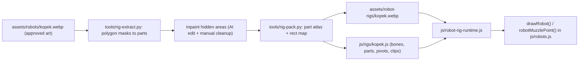

# Robot Animation v2 — Cutout Skeletal Rig Plan

Status: **approved direction, pilot = FIX-8 (`kopek`)**
Date: 2026-11-23
Supersedes the slice-and-shift approach in `docs/robot-spritesheet-animation-plan.md` for rigged robots. The spritesheet system stays in place for robots that are not rigged yet.

---

## 0. Locked decisions

| # | Decision | Consequence |
|---|---|---|
| 1 | **Cutout skeletal rig** (separate limbs rotated around joints, Spine/DragonBones-style) | Plain Canvas 2D, zero dependencies, classic `<script>`, `file://` compatible. No runtime `fetch()`. |
| 2 | **Launcher in the front hand during battle; welder only during the skill** | FIX-8 needs a front gripping hand that does not exist in the source art (it is hidden inside the welder) → must be inpainted/painted. Welder becomes a separate prop part. |
| 3 | **Unrigged robots keep their current spritesheets** | Render priority: rig → spritesheet → static sprite → procedural fallback. Existing sheet code, tests and assets stay untouched. |

Out of scope for this plan: menu/workshop idle, victory pose, new gameplay, network changes.

---

## 1. Why the previous system failed (summary)

| Symptom | Root cause |
|---|---|
| Robot looks frozen or slides | Every frame was the same flattened illustration cut into slabs and shifted a few px. No joints → arms never swing, knees never bend. |
| Seams / cut knees / missing parts | Horizontal slices cut through pelvis and knees; occluded regions do not exist in a flat image. |
| Launcher floats over the face | Weapon drawn at fixed offset `(r*0.28, -r*0.42)`, not attached to a hand; illustration already holds a welder → two tools. |
| Fire/hit/skill look like flicker | Only brightness changes or 5–9 px nudges. |
| Death clipped | Whole image rotated 90° inside a fixed 256×272 cell. |
| State changes pop | Hard frame switches, no blending. |

---

## 2. Architecture overview



### 2.1 New and changed files

| File | Type | Purpose |
|---|---|---|
| `assets/robot-rigs/kopek.webp` | asset | Packed part atlas for FIX-8 (target ≤ 150 KB, ≤ 1024×1024). |
| `art/rigs/kopek/parts/*.png` | source (not shipped) | One PNG per part after extraction + cleanup; reproducible source for the atlas. |
| `art/rigs/kopek/masks.json` | source | Polygon masks and pivots used for extraction (source pixel coordinates). |
| `tools/rig-extract.py` | tool | Cuts parts from the approved illustration using `masks.json`; writes padded part PNGs and a debug overlay. |
| `tools/rig-pack.py` | tool | Packs part PNGs into the atlas, emits atlas rects into `js/rigs/<id>.js`. |
| `tools/rig-check.js` | tool/gate | Validates rig data, atlas rects, clips, ground contact, muzzle path. |
| `js/robot-rig-runtime.js` | runtime | Pose evaluation, blending, procedural layers, drawing, muzzle query. |
| `js/rigs/kopek.js` | data | `ROBOT_RIGS.kopek = {...}` — bones, parts, slots, clips (classic script, global). |
| `js/robots.js` | changed | `drawRobot` / `robotMuzzlePoint` try the rig first. |
| `js/entity.js` | changed (minimal) | Pass event timers already available (fire, land, skill, hit, death) — no gameplay change. |
| `index.html`, test harnesses, probes | changed | Add `js/robot-rig-runtime.js` and `js/rigs/kopek.js` after `js/robot-animation-manifest.js`, before `js/robots.js`. |
| `assets/manifest.json`, `js/assets-manifest.js` | changed | Register `robot-rigs/kopek`. |
| `tools/art-gate.js` | changed | Budget/prefix entry for `robot-rigs/`. |
| `probes/_robot_rig_v2_probe.html` | probe | Rig inspection tool (see §8). |
| `tests/robot-rig-v2.js` | test | Runtime and data tests (see §10). |

Script order (all classic scripts):
`assets-manifest.js → assets.js → characters.js → … → robot-animation-manifest.js → robot-rig-runtime.js → rigs/kopek.js → robots.js → … → entity.js`

---

## 3. Part kit — FIX-8

Coordinates are in the **source illustration space** (`assets/robots/kopek.webp`, 512×544). Boxes are first estimates read from the grid overlay and will be refined in `masks.json` during extraction. The robot faces **right** in the source; "F" = front (near camera, drawn on top), "B" = back.

| Part | Approx. source box (x0,y0–x1,y1) | Pivot (joint) | Parent bone | Notes |
|---|---|---|---|---|
| `antenna` | 78,28 – 118,100 | 106,96 (base) | head | Secondary motion only. |
| `head` | 105,45 – 322,200 | 225,198 (neck) | neck | Includes visor, ear disc, top plate. Visor glow drawn as a separate overlay for hit/death dimming. |
| `visor_glow` | 205,125 – 290,165 | — | head | Mint LED bars as separate layer (brightness/flicker). |
| `neck` | 198,192 – 252,222 | 225,220 | torso | Dark connector; doubles as joint cap. |
| `backpack` | 55,165 – 135,265 | 128,215 | torso | Battery/welder tank with mint bars; behind torso. |
| `torso` | 140,200 – 305,312 | 215,305 (waist) | pelvis | Chest with vents and beige plate. |
| `pelvis` | 188,300 – 252,368 | 220,320 (root) | root | Hip block; hip joints at 165,330 (B) and 250,335 (F). |
| `upperArm_B` | 90,205 – 178,300 | 140,230 (shoulder) | torso | Shoulder pad + upper segment. Drawn **behind** torso in new draw order. |
| `foreArm_B` | 48,270 – 128,350 | 105,282 (elbow) | upperArm_B | Beige cuff. |
| `hand_B` | 55,330 – 125,402 | 90,340 (wrist) | foreArm_B | Fist (closed). |
| `upperArm_F` | 268,205 – 310,300 | 288,222 (shoulder) | torso | Source shoulder retained; generated lower segment completes the shoulder-to-elbow link in the source palette. |
| `foreArm_F` | 285,280 – 330,335 | 300,288 (elbow) | upperArm_F | Generated front forearm; its elbow and wrist centers align to the existing `hand_F` bone vector. |
| `hand_F_grip` | new art, ~44×44 | wrist | foreArm_F | **New part**: closed grip matching `hand_B` style (dark grey fingers, beige knuckle plate). Holds launcher. |
| `prop_welder` | 300,240 – 462,372 | 318,322 (handle) | hand_F_grip / hand_B | Shown only in `skill`. Hose attaches to backpack visually via a short curve drawn at runtime or omitted. |
| `thigh_B` | 128,310 – 190,382 | 165,330 (hip) | pelvis | Beige hip pad + upper leg. |
| `shin_B` | 110,378 – 182,435 | 150,392 (knee) | thigh_B | Orange knee block. |
| `wheelHousing_B` | 75,430 – 180,482 | 140,440 (ankle) | shin_B | Orange mudguard with beige bracket. |
| `wheel_B` | 95,458 – 172,530 | 130,494 (axle) | wheelHousing_B | Rotates; tire + hub. |
| `thigh_F` | 222,315 – 292,392 | 250,335 (hip) | pelvis | |
| `shin_F` | 240,380 – 312,435 | 280,392 (knee) | thigh_F | |
| `wheelHousing_F` | 222,430 – 330,482 | 280,440 (ankle) | shin_F | |
| `wheel_F` | 240,458 – 320,530 | 275,494 (axle) | wheelHousing_F | Rotates. |
| `joint_cap_*` | generated | at each pivot | — | Dark grey (#4a4d55, outline #1d1f24) discs, radius = 0.5 × limb width, drawn under the child part so rotation never shows gaps. |

Total ≈ 22 parts.

### 3.1 Extraction + inpainting workflow

1. **Masks** — author polygons in `art/rigs/kopek/masks.json` (one polygon per part, plus pivot). Each mask extends ~6 px past the visible joint into the neighbour so overlaps exist.
2. **Extract** — `python tools/rig-extract.py kopek` cuts each part from the 512×544 source at full resolution, pads 8 px, writes `art/rigs/kopek/parts/<part>.png` and `art/rigs/kopek/debug/overlay.png` (masks + pivots drawn on the source).
3. **Inpaint hidden regions** — for parts that are occluded in the source (back thigh behind front leg, upper arm under shoulder pad, front forearm behind welder, torso under arms, pelvis sides):
   - Use the `image-generator` agent in **edit mode** with the extracted part + a mask of the missing area and the prompt: *"complete the hidden part of this robot limb, same flat cel-shaded style, same black outline weight, same palette (#e8a020 orange, #e9d3a8 beige, #4a4d55 dark grey, #63e6be mint), transparent background, no new details"*.
   - Paint `hand_F_grip` new from `hand_B` (mirror + adjust fingers into a grip).
4. **Manual cleanup** (required for every part):
   - Alpha edges hard and clean, no halo; outline thickness matches source (≈5 px at 512 scale).
   - Joint ends rounded; no stray pixels from neighbours.
   - Colours sampled from the source palette only.
5. **Review sheet** — `tools/rig-extract.py --review` composes all parts on a checkerboard at 2× with names; **Gate 1**: user approves.
6. **Pack** — `python tools/rig-pack.py kopek` packs parts at **0.5× of source scale** (matches the current 256×272 sprite density) into `assets/robot-rigs/kopek.webp` (WebP q=86, alpha), writes the `atlas` block into `js/rigs/kopek.js`.

### 3.2 Reassembly check
`rig-extract.py --reassemble` draws all parts in bind pose; pixel diff against the source must be **≤ 2 % differing alpha pixels** (excluding the welder→grip change). This proves bind pose = approved art.

---

## 4. Rig data format (`js/rigs/kopek.js`)

```js
/* js/rigs/kopek.js — FIX-8 cutout rig. Generated atlas block + hand-authored bones/clips. */
var ROBOT_RIGS = typeof ROBOT_RIGS !== "undefined" ? ROBOT_RIGS : {};
ROBOT_RIGS.kopek = {
  version: 1,
  atlas: "robot-rigs/kopek",          // asset id
  unit: 256,                           // bind-pose canvas width in rig px (0.5 x source)
  groundY: 265,                        // wheel bottom in rig px (bind pose)
  bones: [                             // parent before child
    { id: "root",   parent: null,     x: 110, y: 160 },
    { id: "pelvis", parent: "root",   x: 0,   y: 0 },
    { id: "torso",  parent: "pelvis", x: -2,  y: -8 },
    // ... neck, head, antenna, backpack, shoulder_B/F, upperArm, foreArm, hand, hip_B/F, thigh, shin, housing, wheel
  ],
  parts: {
    head: { bone: "head", rect: [x, y, w, h], pivot: [px, py] },
    // ...
  },
  drawOrder: [
    "upperArm_B", "foreArm_B", "hand_B",
    "thigh_B", "shin_B", "wheelHousing_B", "wheel_B",
    "backpack", "pelvis", "torso", "neck", "head", "visor_glow", "antenna",
    "thigh_F", "shin_F", "wheelHousing_F", "wheel_F",
    "weapon", "upperArm_F", "foreArm_F", "hand_F_grip", "prop_welder"
  ],
  sockets: {
    weaponGrip: { bone: "hand_F", x: 4, y: 0 },
    contact_B:  { bone: "wheel_B", x: 0, y: 19 },   // wheel radius in rig px
    contact_F:  { bone: "wheel_F", x: 0, y: 19 }
  },
  wheelRadius: 19,
  clips: { idle: {...}, walk: {...}, aim: {...}, fire: {...}, jump: {...},
           fall: {...}, land: {...}, hit: {...}, skill: {...}, death: {...} }
};
```

### 4.1 Clip format

```js
walk: {
  loop: true,
  duration: 600,                      // ms per cycle (overridden by walkPhase when moving)
  phaseDriven: true,                  // time = walkPhase / (2π) * duration
  tracks: {
    thigh_F: { rot: [[0, -22], [300, 22], [600, -22]] },          // [ms, degrees]
    shin_F:  { rot: [[0, 10], [150, 35], [300, 10], [600, 10]] },
    pelvis:  { y:   [[0, 0], [150, -3], [300, 0], [450, -3], [600, 0]] },
    // ...
  },
  ease: "sine"                        // per-key override allowed: [ms, value, "linear"|"in"|"out"|"inout"|"step"]
}
```

Rules:
- Rotations in degrees, relative to bind pose; translations in rig px relative to bind pose.
- Missing track = bind pose value.
- `events` array allowed for visual-only markers (e.g. `{ at: 200, name: "welderOn" }`); never used for gameplay.

---

## 5. Runtime (`js/robot-rig-runtime.js`)

### 5.1 Public API (globals)

| Function | Purpose |
|---|---|
| `getRobotRig(id)` | Returns rig data or `null`. |
| `robotRigReady(id)` | `true` if rig data exists **and** atlas image loaded. |
| `evaluateRobotRigPose(rig, o)` | Returns `{ bones: Map<id, worldMatrix>, visible: Set<part> }` for options `o` (same object passed to `drawRobot`). Pure, deterministic. |
| `drawRobotRig(ctx, rig, o)` | Evaluates + draws; returns `true` on success. |
| `robotRigMuzzlePoint(rig, o)` | World-space muzzle point using the same pose evaluation. |

### 5.2 Per-entity animation state
Stored on a small `WeakMap<Entity|options.animKey, RigAnimState>` inside the runtime (not on the entity, not networked):
`{ state, stateStartMs, prevState, prevPose, blendStartMs }`.
Probes pass a stable `animKey`; Entity passes `this`.

### 5.3 Pose pipeline (per draw)
1. **Resolve state** — reuse `resolveRobotAnimation(o, timeMs)` (death > hit > skill > land > fire > jump/fall > walk > aim > idle).
2. **Clip time** — one-shot clips use `timeMs - stateStartMs`, clamped; loops wrap; `walk` is phase-driven from `motion.walkPhase` so stride length is locked to distance travelled (no skating).
3. **Sample clip** → local transforms per bone.
4. **Crossfade** — on state change, blend from the last pose to the new clip over **100 ms** (death: 60 ms, fire: 40 ms) with smoothstep weight; rotations blended by shortest angle.
5. **Procedural layers** (applied after the clip, in order):
   - **Aim IK** (states `idle`, `walk`, `aim`, `fire`, `land`, `fall`, `jump` while the robot holds the launcher): 2-bone analytic IK for `upperArm_F`/`foreArm_F` so that the `weaponGrip` socket sits at a target point on the aim ray, and the weapon bone is rotated to `localAim`. Target point = shoulder + `reach` × (cos localAim, sin localAim), `reach` = 0.85 × (upper + fore length). Elbow bends downward (bend sign fixed). Torso adds up to ±8° lean toward the aim when |localAim| > 30°.
   - **Wheel spin** — `wheel.rot = distance / wheelRadius` where `distance = walkPhase * strideLength / (2π)`; in idle wheels hold their last angle.
   - **Ground lock** (grounded states) — compute world y of `contact_B` and `contact_F`; shift `root` so the lower contact lies exactly on the ground line (`local y = +r`). Prevents floating/sinking whatever the clip does.
   - **Secondary motion** — antenna and backpack follow torso rotation with a damped spring (k = 120, d = 14), integrated from `timeMs`, deterministic per frame delta, clamped ±18°.
   - **Visor** — `visor_glow` alpha: 1.0 normal, flicker in `hit`, fades to 0 in `death`.
6. **Draw** — `ctx.save(); translate(cx, cy); scale(facing, 1)` then for each part in `drawOrder`: set world matrix, `drawImage(atlas, rect…)`, joint caps underneath child parts. Hit/shield flash = second pass with `globalCompositeOperation = "source-atop"` on an offscreen buffer **only when the flash is active** (no cost otherwise).

### 5.4 Scale contract
`scale = (r * RB_VISUAL_SCALE * 2.32) / rig.unit` — identical on-screen width to the current static sprite and sheets, so physics radius, shadow, team ring, HUD bars and hit tests are unchanged. Ground: rig `groundY` maps to local `y = +rawR` (same equation as today: `drawY = rawR - drawH * groundY/height`).

### 5.5 Weapon contract
- The launcher sprite (`weapons/launcher`) becomes a rig slot `weapon` parented to `weaponGrip`.
- `robotMuzzlePoint()` for rigged robots returns `robotRigMuzzlePoint()` — computed from the same bone chain, so the drawn muzzle and projectile spawn coincide (existing test "Nişan hizası — çizilen namlu ağzı ile muzzle aynı noktada" must keep passing; it will be extended to rigged robots).
- Projectile spawn may move by a few px compared to today; gameplay tests that pin exact spawn positions will be checked. If any multiplayer determinism test depends on muzzle position, muzzle is computed from **pose inputs that are already synced** (aim, facing, position, onGround) and deterministic clip time, never from local wall-clock blending. Fallback: keep the old muzzle formula for gameplay and use the rig muzzle only for drawing, with the weapon positioned so both coincide — decided in phase 4 after running `tests/net-*.js`.

### 5.6 Welder prop (decision 2)
- Battle states: `hand_F_grip` holds the launcher; `prop_welder` hidden.
- `skill` clip (Acil Onarım): `hand_B` reaches to the backpack (0–150 ms), `prop_welder` becomes visible in `hand_B` (event `welderOn`), torch tip aims at chest plate and holds (150–450 ms; the arc/sparks remain in `skill-fx`), returns and hides (450–600 ms). The launcher stays in the front hand, lowered by 20°.

### 5.7 Mirroring
Default horizontal mirror (`scale(-1,1)`), same as today. FIX-8 has no text/asymmetric markings that break when mirrored; verified in the probe. If needed later, a rig may provide `mirrorDrawOrder` to swap F/B layering.

### 5.8 Performance budget
- ≤ 26 `drawImage` calls per robot per frame; 8 robots on screen ≈ 210 calls — negligible for Canvas 2D.
- Pose evaluation: allocation-free hot path (preallocated Float32Array matrices per rig instance).
- Target: < 0.15 ms per robot on the dev machine (measured in the probe).

### 5.9 Failure handling
Any missing rig data, missing atlas, NaN in a pose, or thrown error → `drawRobotRig` returns `false` and `drawRobot` continues with the spritesheet → static sprite → procedural chain. Errors logged once per robot id via `diagnostics.js` if present.

---

## 6. Integration in `js/robots.js` / `js/entity.js`

```text
drawRobot(ctx, o):
  1. if robotRigReady(def.id) and drawRobotRig(ctx, rig, o) → return true
  2. spritesheet path (unchanged)
  3. static sprite path (unchanged)
  4. procedural path (unchanged)

robotMuzzlePoint(...):
  if robotRigReady(id) → robotRigMuzzlePoint(...)   (see §5.5 decision gate)
  else existing formula
```

Entity signals passed to `drawRobot` (all already exist or are visual-only timers):

| Signal | Source | Used for |
|---|---|---|
| `motion.vx/vy/onGround/walkPhase/walkAmp` | Entity | walk/jump/fall, wheel spin |
| `aim`, `motion.aiming` | Entity / active turn | aim IK |
| `recoil` (`weaponRecoil`) | Entity | fire clip trigger |
| `visualHitTimer` → `hitFlash` | Entity | hit clip trigger |
| `skillPoseKind` / `skillPoseTimer` | Entity | skill clip trigger |
| `landTimer` (new, visual only) | Entity: set on air→ground transition | land clip |
| `alive` | Entity | death clip (holds last frame) |

`landTimer` is the only new field; it does not affect physics or networking (derived locally from `onGround` transitions on every client).

---

## 7. FIX-8 clip specification

All angles in degrees relative to bind pose (positive = clockwise in screen space, robot facing right). Times in ms.

### idle — loop, 1600 ms
| Bone | Keys |
|---|---|
| pelvis y | 0:0 · 800:+2 · 1600:0 |
| torso rot | 0:0 · 800:-1.5 · 1600:0 |
| head rot | 0:0 · 900:+2 · 1600:0 |
| upperArm_B rot | 0:0 · 800:+4 · 1600:0 |
| foreArm_B rot | 0:0 · 900:+6 · 1600:0 |
| thigh_B / thigh_F rot | constant +4 / -4 (slight A-stance) |
| shin_B / shin_F rot | 0:6 · 800:9 · 1600:6 (knees soften with bob) |
| antenna | spring only |
| front arm | aim IK (weapon slowly rises/falls with pelvis) |

### walk — loop, phase-driven, 600 ms per cycle
| Bone | Keys |
|---|---|
| thigh_F rot | 0:-22 · 300:+22 · 600:-22 |
| thigh_B rot | 0:+22 · 300:-22 · 600:+22 |
| shin_F rot | 0:10 · 150:35 · 300:10 · 600:10 (bends during swing 0–300) |
| shin_B rot | 0:10 · 300:10 · 450:35 · 600:10 |
| wheelHousing_F/B rot | counter-rotate thigh+shin so the housing stays near horizontal (computed: `-(thigh+shin)*0.8`) |
| pelvis y | 0:0 · 150:-3 · 300:0 · 450:-3 · 600:0 |
| torso rot | constant -6 (lean forward) + 0:-1 · 300:+1 · 600:-1 |
| upperArm_B rot | 0:+18 · 300:-18 · 600:+18 (counter-swing to thigh_B) |
| foreArm_B rot | 0:10 · 300:25 · 600:10 |
| head rot | 0:+1 · 300:-1 · 600:+1 |
| wheels | spin from distance; swing-leg wheel lifts 4 px (shin bend handles it) |

### aim — hold
torso rot toward aim (IK lean, max ±8) · thigh_F -10 / thigh_B +10 · shin 12 · pelvis y +2 · head follows aim ×0.3.

### fire — once, 250 ms
| Bone | Keys |
|---|---|
| weapon local x (along barrel) | 0:0 · 40:-8 · 250:0 (ease out) |
| foreArm_F rot (on top of IK) | 0:0 · 40:-15 · 250:0 |
| torso rot | 0:0 · 50:+5 · 250:0 (lean back) |
| pelvis x | 0:0 · 60:-2 · 250:0 (wheels roll back) |
| head rot | 0:0 · 60:+4 · 250:0 |
| antenna | spring receives impulse |

### jump — once, 300 ms (then holds last key until `fall`)
0–100 crouch: shin +45, thigh ∓15, pelvis y +8, arms down · 100–180 extend: shin 0, thigh 0, pelvis y -6, upperArm_B -40 · 180–300 tuck: shin +60, thigh -25, wheelHousing up.

### fall — loop, 400 ms
thigh_F -10 · thigh_B +15 · shin 20↔28 · upperArm_B -55 (balance) · torso -4 · antenna trails up (spring).

### land — once, 250 ms
0: contact pose (legs reaching) · 60: squash (shin +50, thigh ∓20, pelvis y +8, torso +4, head -3) · 140: rebound (pelvis y -2) · 250: idle pose.

### hit — once, 300 ms
0–60: head +12, torso +10, pelvis x -4, upperArm_B -30, visor flicker · 60–180: overshoot forward (torso -3) · 180–300: back to base. Flash overlay from existing `hitFlash`.

### skill (Acil Onarım) — once, 600 ms
0–150: hand_B reaches to backpack (upperArm_B -70, foreArm_B -60), torso turns -4 · 150: `prop_welder` visible in hand_B · 150–450: torch tip to chest plate (upperArm_B +20, foreArm_B -80), torso +3, small tremor ±1° on hand_B (welding) · 450–600: back to idle, welder hidden. Launcher lowered 20° during the clip.

### death — once, 900 ms, holds last pose
0–120: visor flickers, torso +6 · 120–300: knees buckle (shin +50, thigh -30), pelvis y +10, head -10 · 300–550: whole root rotates to -80° around the front wheel contact, torso slumps · 550–700: impact, root y bounce -6 → 0, antenna/head spring impulse · 700–900: settle; visor alpha 0; launcher drops from hand (weapon slot detaches to ground, rotation 0). Rendered without a cell → never clipped. Ground lock disabled after 300 ms; instead the rotated body's lowest point is clamped to the ground line.

---

## 8. Tooling — `probes/_robot_rig_v2_probe.html`

- Robot selector (only rigged robots active; others show "spritesheet" badge).
- State buttons for all 10 states + "auto" (simulated Entity driving: walk left/right, jump, land, fire, hit, skill, die).
- Timeline scrubber per clip, play/pause, step ±1 frame (16 ms), speed 1× / 0.5× / 0.25×.
- Zoom 1× (match scale) / 3× / 6× / 8×, side-by-side match-scale view always visible.
- Overlays: bones + pivots, part bounds, sockets (grip, muzzle, contacts), ground line, muzzle ray.
- Onion skin (previous/next 3 poses at 25 % alpha).
- Aim slider (-180…180) and facing toggle.
- Slope test: ground line rotated ±20°, crater curve.
- Crowd test: 8 robots (rigged + sheets) at match scale.
- Perf readout: ms per robot evaluate+draw.

Same `<base href="../">` and classic script list as other probes.

---

## 9. Gates (tools)

`node tools/rig-check.js` (added to `npm run verify`):
- Every rig: atlas asset registered; every part rect inside atlas bounds; every part bone exists; bones topologically ordered; drawOrder contains every part exactly once.
- All 10 clips present; key times sorted and within `duration`; values finite; rotation range sane (|rot| ≤ 180).
- Ground: evaluate grounded clips (idle, walk, aim, fire, land end, hit, skill) at 16 ms steps → lower contact within ±1 rig px of `groundY` after ground lock; max upward drift without lock ≤ 6 px (catches badly authored clips).
- Height stability: bind-pose bounding height vs. every sampled pose height in grounded clips within ±6 %.
- Muzzle: for aim angles every 15°, muzzle lies outside the head part bounds (weapon never over the face).
- Death: final pose fully inside a 3×r wide box above the ground line.

`node tools/art-gate.js`: new budget row `robot-rigs/` (perAsset 200 KB, total 34 × 200 KB), alpha required, WebP signature, manifest size match.

---

## 10. Tests — `tests/robot-rig-v2.js`

1. Data: `ROBOT_RIGS.kopek` passes the same structural checks as rig-check (runs in Node with the harness).
2. Pose determinism: same inputs → identical matrices.
3. State resolution reuse: rig follows `resolveRobotAnimation` for each state.
4. Crossfade: weight 0 at change, 1 after blend time; no NaN; shortest-angle rotation.
5. One-shot clips return: `fire`, `land`, `hit`, `skill` end in the base state; `death` holds.
6. Walk phase lock: wheel angle and stride proportional to `walkPhase`; zero phase change → zero wheel change.
7. Aim IK: grip socket on the aim ray within 0.5 px for reachable angles; elbow bend sign constant; facing -1 mirrors correctly.
8. Muzzle contract: `robotMuzzlePoint` equals drawn weapon muzzle (recorded via mock ctx transform) within 0.5 px, both facings.
9. Fallback: missing atlas / missing rig / corrupted clip → `drawRobot` returns true via spritesheet path; no throw.
10. Unrigged robots: draw path identical to today (sheet calls recorded and compared).
11. Welder visibility: hidden in all states except `skill` window.
12. Gameplay invariance: run existing `tests/run.js`, `tests/net*.js`, `tests/robot-animation.js`, `tests/robot-rig.js` unchanged and green.

Harness updates: add new scripts to `tests/harness.js` load list and to every probe that loads `js/robots.js` (rule 2 in `AGENTS.md`).

---

## 11. Phases and approval gates

| Phase | Work | Deliverable | Gate (user) |
|---|---|---|---|
| **1. Part kit** | masks.json, rig-extract, inpaint, cleanup, new grip hand, welder prop, reassembly diff | `art/rigs/kopek/parts/*.png`, review sheet PNG | Approve part review sheet at 2× |
| **2. Rig core** | rig-pack, `js/rigs/kopek.js` bones/bind pose, runtime (eval, draw, ground lock, wheel spin, aim IK, spring), probe v2 | idle, walk, aim in probe | Approve idle/walk/aim feel (6× and match scale) |
| **3. Full clips** | fire, jump, fall, land, hit, skill, death, crossfades, visor | all 10 states in probe | Approve each state (checklist in §12) |
| **4. Game integration** | drawRobot/robotMuzzlePoint hook, entity `landTimer`, script lists, manifest, art-gate, rig-check, tests | FIX-8 rigged in real matches | In-match check: both facings, slope/crater, crowd, online match |
| **5. Roll-out** | family clip templates + per-robot part kits | robots move from sheets to rigs family by family | Approve per family |

Phase 5 family order (clips are shared per family, parts are per robot):
1. Wheel-legs / wheels humanoids (FIX-8 template): kokarca, sirtlan, ornitorenk, penguen, + wheel: kedi, koala, kunduz, gergedan, sincap.
2. Legs: tilki, kaplan, ordek, aslan, kurtadam, dino, bukalemun, zurafa.
3. Tracks: ayi, panda, timsah, suaygiri, yeti, armadillo, ejderha, oklukirpi.
4. Spring: tavsan, maymun, kanguru.
5. Ball: rakun, kirpi, hamster.
6. Rotors: yarasa, kus.

Each robot keeps its spritesheet until its rig passes the gates (decision 3).

---

## 12. Acceptance checklist (per rigged robot)

- [ ] Bind pose matches the approved illustration (reassembly diff ≤ 2 %).
- [ ] At 6×: arms swing, knees bend, wheels visibly rotate; no gaps or seams at any joint in any state.
- [ ] Weapon always in the front hand, follows aim through the full range, never over the face.
- [ ] Wheels on the ground line in grounded states; no floating, no sinking; same on slopes within ±20°.
- [ ] Height stable across states (only breathing/squash amplitudes).
- [ ] No pops between states; one-shots return to the right base state; death holds and is never clipped.
- [ ] Mirror looks correct.
- [ ] Match scale (1×) readable in an 8-robot crowd.
- [ ] Skill shows the welder only during the skill; effects still come from `skill-fx`.
- [ ] Commands green: `node tests/run.js`, `node tests/robot-animation.js`, `node tests/robot-rig.js`, `node tests/robot-rig-v2.js`, `node tests/net.js`, `node tests/net-state.js`, `node tests/i18n.js`, `node tools/art-gate.js`, `node tools/rig-check.js`, `node tools/build.js --dry`, `bash ~/.pi/agent/bin/verify.sh`.

---

## 13. Risks and mitigations

| Risk | Mitigation |
|---|---|
| Inpainted areas do not match the style | Inpaint only small hidden regions; manual cleanup pass; review gate before any rigging. |
| Joint gaps at large angles | Overlapping masks + joint caps + angle limits in rig-check. |
| Muzzle change breaks gameplay/online tests | Decision gate in phase 4 (§5.5): rig muzzle for drawing only if tests require the old spawn point. |
| Mirrored front/back layering looks wrong | Optional `mirrorDrawOrder` per rig. |
| Cost of 34 part kits | Family templates for clips; part extraction tooling reused; only masks + cleanup per robot. |
| Atlas budget | 0.5× scale packing, WebP q=86, art-gate budget 200 KB per rig. |
| Unrigged robots still look weak | Accepted by decision 3; they move to rigs family by family. |

---

## 14. Commit plan

1. `feat(rig): FIX-8 part kit sources and extraction tools` (phase 1)
2. `feat(rig): cutout rig runtime and FIX-8 idle/walk/aim` (phase 2)
3. `feat(rig): FIX-8 full combat clip set` (phase 3)
4. `feat(rig): integrate rig rendering into drawRobot with sheet fallback` (phase 4)
5. One commit per family in phase 5.

Each commit runs the relevant checks from §12 before it is created.
